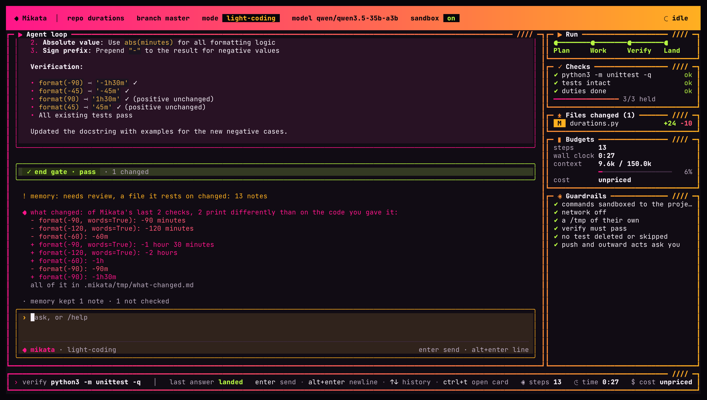
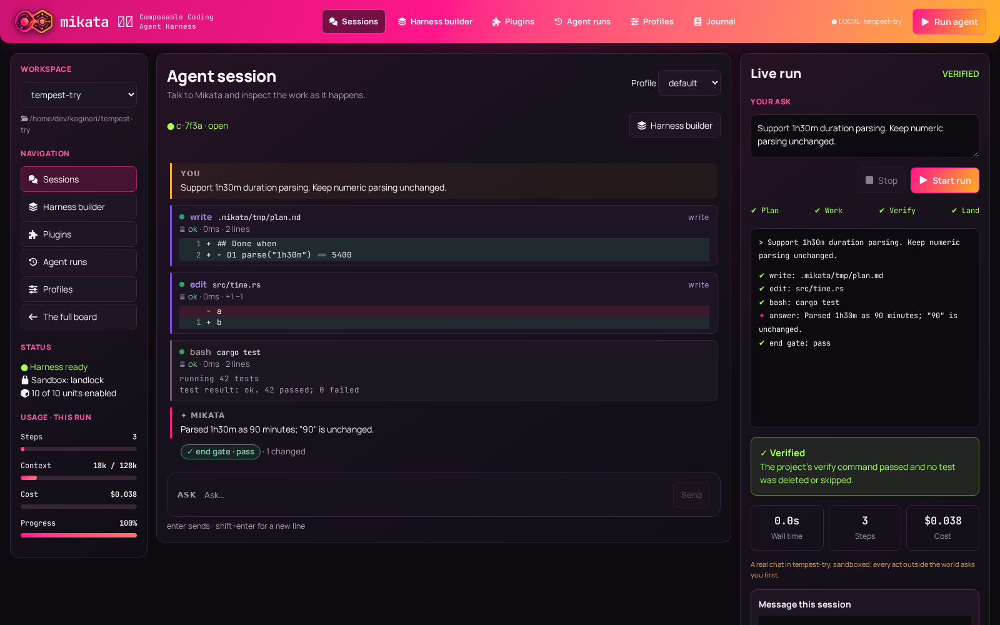

<p align="center">
  
</p>

# Mikata

**The coding agent on your side.** *Mikata* (味方) is Japanese for *ally*.

You tell Mikata what to change. It works in your repository, runs your tests, and checks its own
work before it answers. Nothing lands until your tests pass and no test was deleted or skipped.
Nothing leaves your machine without your yes.

Mikata is a harness: the program around a language model that gives it tools, keeps it safe and
holds it to its word. Bring any model; Mikata makes it careful.

## What it does for you

- **It checks before it answers.** Every change passes the **end gate**: your project's test
  command runs green, and no test is deleted or skipped.
- **It holds you to your words, and itself to them too.** Write what "done" means under
  `## Done when` in your ask, and the harness runs each line on the finished work. A *reader*
  model can write those lines for you from a plain-language ask.
- **It asks before it acts outside.** A push, a pull request, a publish or a deploy waits for
  your approval on a card. Every command runs in a sandbox.
- **It keeps your secrets.** `.env` files, keys, kubeconfigs and Terraform state are found when a
  session opens. The model sees their keys, never their values.
- **It shows you what changed.** When an answer lands, Mikata runs its checks again on your code
  as it was and as it is now, and shows you where they differ.
- **It remembers.** What a session learns is kept in your repository, in `.mikata/`. Tell it when
  it was wrong, and the next session starts from your correction.
- **It splits big asks.** Name several projects in one ask and Mikata works on each at once, then
  checks each one.

## How it does on our bench

Ten real fixes in a large Python library, the same small open model in every harness, each task
run twice a week apart:

| Harness | Passed | Cost per pass |
|---|---|---|
| **Mikata** | **16 of 20** | **$0.50** |
| Maki | 15 of 20 | $0.91 |
| OpenCode | 14 of 20 | $0.87 |

On passes, the three are level: the difference is within what chance allows. Mikata costs less
here, but not everywhere: on smaller JavaScript fixes Maki was cheaper. Every number, with its
method and its failures, is on [the bench](docs/bench.md).

## Install

Linux (x86_64, arm64) and macOS (Apple Silicon, Intel):

```sh
curl -fsSL https://raw.githubusercontent.com/Kaginari/mikata/main/install.sh | sh
```

The installer checks each download against the release's `SHA256SUMS`, needs no sudo, and puts the
binaries in `~/.local/bin` (`--dir` to choose another). Other ways — a given version, by hand, or
from source — are in [Install, in detail](#install-in-detail).

## Set a model

Name a provider and a model once, in `~/.config/mikata/config.toml`:

```toml
[providers.openrouter]
kind = "openai"
base_url = "https://openrouter.ai/api"
key_env = "OPENROUTER_API_KEY"     # the variable that holds your key — never the key itself

[models]
provider = "openrouter"
default = "anthropic/claude-sonnet-5.5"
```

Then give Mikata your project's test command: the end gate runs it on every change, and until a
project has one there is nothing to check. `mikatad memory status` suggests one (`cargo test
--workspace`, `pytest`, `npm test`, …). Put it on the `Verify:` line of
`.mikata/summoner/summoner/README.md`; the next time you start `mikata` there, it asks you once
whether to trust it (`mikatad verify pin summoner` does the same). `mikata status` shows what is
pinned.

## Use it

```sh
export OPENROUTER_API_KEY=…
cd ~/code/my-project

mikata                       # the terminal app
mikata --web                 # the web board, opened in your browser
mikata run "<ask>"           # one ask, no app: the answer on stdout
mikata status                # the model, the key, the sandbox, what is switched on
mikata resume last           # pick up the last run that stopped
```

`mikata run` exits 0 only when the answer landed, so scripts can trust it. It denies every act
that needs your approval unless you pass `--gate-tty`.

**Ask well.** Give an example of what must change and one of what must not. On our bench, an ask
with examples passed twice as often as the same ask in prose.

**Say when it was wrong.** In the terminal app, type `/wrong <what is wrong>` after an answer, then
`/keep`. The next time that ask comes, your words come first; written as a case
(`` `total 1 2` must give `6` ``), they become a line of its "done" list, and an answer that leaves
it wrong does not land. Outside the app: `mikatad memory wrong "<what still fails>"`.

### The terminal app



Three views; **F2** switches between them. **Light**, the default, puts the conversation beside
one slim column: the run's steps (Plan · Work · Verify · Land), the checks, the files changed, the
budgets. **Advanced** shows every panel. **Focus** shows the conversation alone.

### The web board



`mikata --web`, or `mikatad board --open`, opens the board on your machine. It shows every
project you work in and their sessions. Start a session from the **Harness Builder**, where you
choose what is switched on. Follow it live, answer its approvals, and read past runs.

The board listens on your machine only. From another machine, forward the port over SSH
(`ssh -L 7878:127.0.0.1:7878 <host>`).

## Make it yours

Every part of Mikata's loop is a **unit** you can switch on or off: memory, the end gate, the held
"done" list, the reader, what-changed, the approval card, the secret files, and more. Switch them
in the board's Harness Builder, with `/unit on|off <name>` in the terminal app, or under `[units]`
in your config. The Builder also picks the model a new session rides. A **profile** names a mix for a kind of work. A **plugin** adds a unit of your own.
See [the architecture](docs/03-architecture.md) and [plugins](docs/experimental/plugins.md).

## Read more

| Page | What it tells you |
|---|---|
| [Overview](docs/01-overview.md) | what Mikata does with an ask, in one picture |
| [The loop](docs/02-loop.md) | one turn, start to finish, and the end gate |
| [Architecture](docs/03-architecture.md) | the parts, the terminal app, the board, the sandbox, configuration |
| [The client protocol](docs/04-protocol.md) | how programs talk to Mikata |
| [Consumption](docs/05-consumption.md) | how spending is budgeted and stopped |
| [MCP](docs/06-mcp.md) | connecting MCP servers |
| [Memory](docs/07-memory.md) | what Mikata remembers, and why |
| [The bench](docs/bench.md) | every measurement, with its method |
| [Roadmap](docs/roadmap.md) · [Lessons](docs/lessons.md) · [Releasing](docs/releasing.md) | what comes next, what we learned, how a version ships |
| [The lab](docs/experimental/) | Mikata's past as Mnemorph: races, chains, collectives, kept and frozen |

## Install, in detail

**A given version, or another folder:** `sh install.sh --version 1.2.0 --dir ~/bin`.

**By hand**, from [the releases](https://github.com/Kaginari/mikata/releases): download
`mikata-<target>.tar.gz` and `SHA256SUMS`, then:

```sh
sha256sum -c --ignore-missing SHA256SUMS     # macOS: shasum -a 256 -c --ignore-missing SHA256SUMS
tar -xzf mikata-x86_64-unknown-linux-gnu.tar.gz
cp mikata-*/mikata mikata-*/mikatad mikata-*/mikata-guard ~/.local/bin/   # no guard on macOS
```

**From source**, in a checkout:

```sh
pnpm install --frozen-lockfile && pnpm --filter @mikata/board build   # the web board first
cargo install --path crates/mikata-tui       # mikata
cargo install --path crates/mikatad          # mikatad
cargo install --path crates/mikata-sandbox   # mikata-guard (Linux)
```

Three programs, one core:

| Program | What it is |
|---|---|
| `mikata` | the terminal app, and `mikata run` for scripts |
| `mikatad` | the web board, the server for the TypeScript SDK, and housekeeping commands (`mikatad runs`, `mikatad memory`, …) |
| `mikata-guard` | on Linux, the sandbox every command runs through; without it, Mikata runs no command |

**Keys.** `key_file = "~/.config/mikata/openrouter.key"` reads the key from a file when the variable
is unset. The file must be yours, mode `600`, and outside every project. Providers, keys and
spending caps are read only from your global config, never from a project's.

**Coming from Mnemorph?** The first run moves `.mnemorph/` folders and config to their Mikata
names and says so. Use `MIKATA_*` environment variables instead of `MNEMORPH_*`.

## Build it

You need Rust (pinned in `rust-toolchain.toml`), Node 22, pnpm (`corepack enable`), and
[just](https://just.systems). For the full check, also cargo-nextest, cargo-deny,
cargo-llvm-cov and actionlint.

```sh
just setup     # install the TypeScript workspace
just           # the full check: Rust, TypeScript, layering, the book, the workflows
just docs-dev  # read the book as a website while you write it
```

| Folder | Holds |
|---|---|
| `crates/` | the Rust core, one crate per concern |
| `packages/` | TypeScript: the protocol, the SDK, the theme, the board |
| `docs/` | this book; `docs/experimental/` is the lab |
| `site/` | the book as a website |
| `assets/` | Mikata's logo and icons |
| `.mikata/` | Mikata's own project memory and journal |
| `tools/` | repository checks |

What changed in each version is in [the changelog](CHANGELOG.md). Mikata is MIT licensed
([LICENSE](LICENSE)); what it bundles is in [third-party notices](THIRD-PARTY-NOTICES.md).
