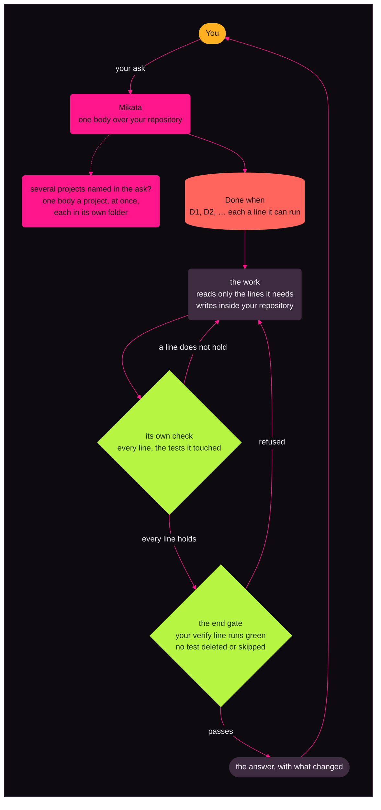
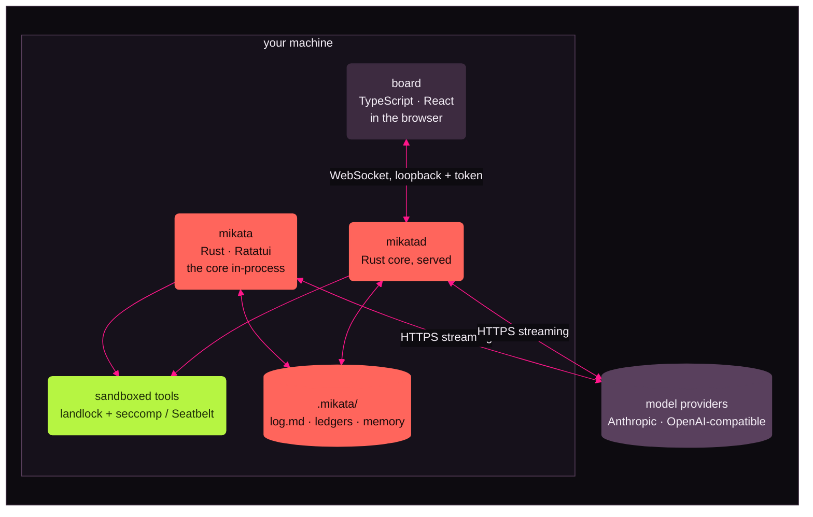

# Overview

## In one picture

## In plain words

**Mikata** (味方, "ally": the one on your side) is a coding agent. You give it an ask; one body
works through it over your whole repository, the way a careful engineer would:

1. **It writes down what "done" means, first:** every output your ask states and every case that
   must keep working, each a line `D1`, `D2`… it can run.
2. **It weighs two or three ways** to do the ask, with what each risks, and picks one.
3. **It does the work,** reading only the lines it needs.
4. **It checks before it answers:** it runs every line of its list and the tests of what it
   touched. A difference or a red test means not done.
5. **The end gate judges every file it changed:** your verify line runs green, and no test was
   deleted or skipped.

6. **You are shown what changed, by its own checks:** when the answer has landed, its last
   checks are run again on the code as you gave it and on the finished work, and you see where
   they print differently ([the loop](02-loop.md#what-changed-by-its-own-checks)). No model reads
   that list. You do.

That habit, writing "done" down and checking it, took Mikata from 5 of 10 to level with OpenCode
and Maki on our bench, at about half their price per pass on the fixes it was built on. It takes
calls: on smaller fixes in a second codebase, and with a stronger model that needs no help, the
three stay level on passes and Mikata is not the cheapest ([the bench](bench.md)). It needs
nothing set up.

**You can write the list yourself, or have a reader write it.** Lines under `## Done when` in your
ask (`D1: ... must give ...`, `D2: ... must stay as it is today`) are held by the harness, not
by Mikata's word: it hands in one command a line, the harness reads what must stay from your
code before anything changes, and runs every line when the answer lands
([the loop](02-loop.md#a-done-when-list-in-the-ask)). Name a model as `models.reader` and it
writes those lines for each ask, from the ask alone. On the two asks our bench fails most, that
is the difference between 1 pass in 6 and 6 in 6; on four asks stated as prose, with nothing
added but the reader, between 6 passes in 12 and 10. The list is what does it: the same lists
handed over as a plain note, held by nothing, passed 11 in 12, and 8 in 12 in each of the two
other harnesses we run beside Mikata, where those passed 5 and 3 without
([the bench](bench.md#the-list-held)). What the hold adds is a pass that names what verified it
and what must stay read from your code; it costs about four dollars in ten more a run and is not
shown to add passes. Read the list a reader writes: the harness holds whatever it says, and
names in its pass any line whose check showed nothing of the work.

**An ask that names several projects is split by itself.** When the ask names two or more folders
at the root of your repository that each hold a project file of their own (`pyproject.toml`,
`Cargo.toml`, `package.json`, `go.mod`, …), Mikata runs one body a project, at once, each with its
folder as its root, then checks each project once before it answers. Five whole repositories in
one ask: one body fixed 2.5 of 5 on average; one body a project, 4.5 of 5.

**It acts outside only with your word.** Mikata reads and writes inside your repository, and every
command runs in a sandbox. When the ask needs an act that leaves your machine (a push, a pull
request, a publish, a deploy), Mikata does it itself, and each one shows you an approval card first:
denied, it stays undone. `mikata run` denies every such act unless you pass `--gate-tty`.

**What it learns stays with the repository.** Everything that matters is written to the world
folder, `.mikata/`: the journal `log.md`, the ledgers, memory. Sessions forget; the world
remembers.

### Say what the result must be

Mikata checks its work against what the ask states. On four tasks, an ask with its examples and
their expected output passed 4 times in 4; the same ask as one paragraph of prose passed 4 times
in 8, at the same price. Without examples the body writes its own checks from its own reading of
the ask, and a wrong reading passes them: one task failed 4 times in 4 on a case the ask said, in
words, must stay as it was. One example of what must change and one of what must not is worth more
than a paragraph.

When you did write prose, read the last lines Mikata shows you: what its own checks print now and
printed before. In 21 of the 25 runs that failed on our prose asks, the mistake is in those lines,
and it is quicker to see there than in a diff.

### The modes

Every session opens in **light-coding**: the one body above. `mikata status` says the mode and
why. Two other modes, where the work is handed down a chain of bodies or shared by a collective,
are kept as [experimental](experimental/): usable, measured, and frozen, since one body a project
did better on every screen.

### Compose it (experimental)

Every part of the loop is a **unit** you can switch: memory, the end gate, the held `Done when`
list, the fold, the stress signals, what-changed, the reader, the challenge, and the prompt's plan
and its lighter form, both off by default (`[units]` in your global file, `--units` on `mikata
run`, `/unit on|off` in the terminal). A **profile** names a mix for a kind of work (`--profile
planned` puts the plan back, `--profile prose` its lighter form).
A **plugin** is a program of yours that speaks MCP plus `mikata/hook`, run in the sandbox under a
deadline, and loaded, unloaded or swapped while a session runs ([plugins](experimental/plugins.md)).
The board's **Harness Builder** draws the units round the core and starts a run with exactly
that composition. What each unit is worth is measured one at a time
([plugins: where it stands](experimental/plugins.md#where-it-stands)).

## Technical detail

### The processes

- **The core** (Rust crates) owns everything that must be correct: the loop, the gate, the
  sandbox, the ledgers, the provider clients. It has no UI, and every surface links the same
  crates.
- **`mikata`** (Rust, Ratatui) is the command you run. With no subcommand it is the terminal
  app; `mikata run "<ask>"` asks once without it, for scripts. It hosts the session in its own
  process, with no protocol between the screen and the core, and draws the same events the server
  sends ([the terminal UI](03-architecture.md#the-terminal-ui)). It renders; it decides nothing.
- **`mikatad`** (Rust) is the core as a server: JSON-RPC 2.0 over stdio for the TypeScript SDK
  ([the client protocol](04-protocol.md)), the web board on loopback, and the world's admin
  commands (`mikatad runs`, `mikatad memory status`, …).
- **The board** (TypeScript, React) is the web cockpit, served by `mikatad` on loopback. It
  speaks the same protocol over a WebSocket; its Harness Builder composes a run's units and
  follows the run live.
- One protocol, defined once in Rust; the TypeScript types are generated from it. A client can
  never drift from the core.

### What is fixed and what is yours

| Compiled in (code) | Configured (data) |
|---|---|
| the loop, its budgets and stress instruments | the provider and the model |
| the end gate's checks | your verify line (the project's test command) |
| the classes of an act: `read`, `write`, `outward`, `destructive` | guard rules that ask you instead of refusing |
| the sandbox's rules | budgets: amounts per session, day, month |
| the meters and the ledgers | provider credentials, by reference, never inline |
| the split by project | MCP servers, and Minds: know-how a body can load |

### Where it comes from

Mikata grew out of [isekai](https://github.com/Kaginari/isekai) and was called **Mnemorph** until
November 2026. Mnemorph's idea was a kingdom of races, each a different kind of body with its own
tools: Elves that plan, Orcs that judge, Slimes that write. The bench kept the discipline and
dropped the kingdom: one body that writes "done" down and checks it beat the chain of races on
every screen. The races live on as the [experimental lab](experimental/), and their rules live
on inside the one body.
