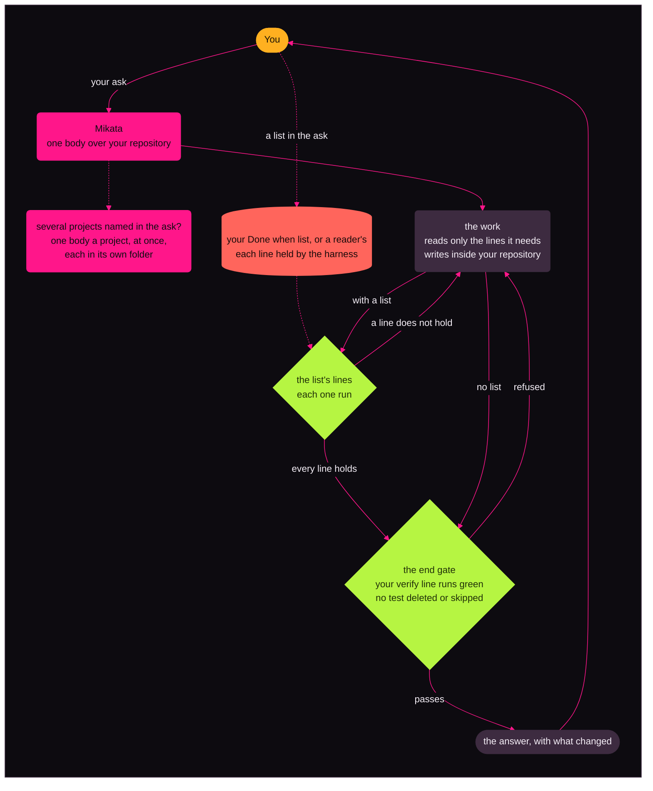
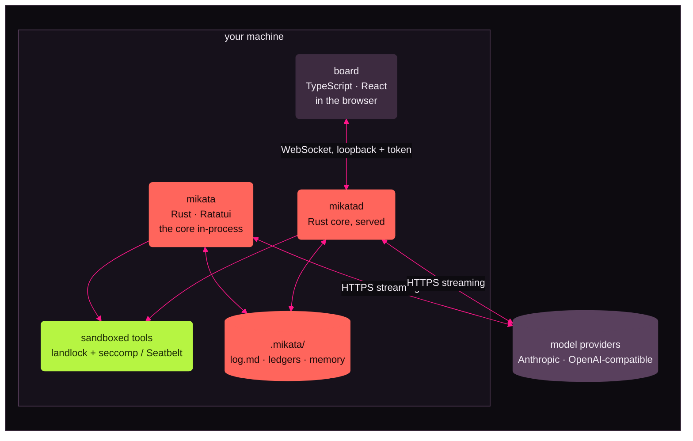

# Overview

## In one picture



## In plain words

**Mikata** (味方, *ally*: the one on your side) is a coding agent. You give it an ask. One agent,
Mikata, works through it over your whole repository, the way a careful engineer would:

1. **It does the work.** It reads only the lines it needs, writes inside your repository, and runs
   what it needs to run: the tests, a build, a script. Every command runs in a sandbox.
2. **It is held to "done".** If your ask says what done means, under `## Done when`, the harness
   runs each line on the finished work before the answer lands.
3. **It passes the end gate.** Your project's test command runs green, and no test was deleted or
   skipped. Until then, nothing lands.
4. **It shows you what changed.** Its last checks run again on your code as it was and as it is
   now, and you see where they differ. No model reads that list; you do.

**It asks before it acts outside.** A push, a pull request, a publish or a deploy waits for your
approval on a card. Denied, it stays undone. `mikata run`, made for scripts, denies every such act
unless you pass `--gate-tty`.

**It keeps your secrets.** `.env` files, keys, kubeconfigs and Terraform state are found when a
session opens. The model sees their keys and never a value; no tool writes or searches them; a
command finds them empty, unless it is an act you approved, such as a deploy. Any value that
slips into a result is struck out before the model reads it.

**It remembers.** What matters is written to your repository's `.mikata/` folder: the journal,
the ledgers, memory. Sessions forget; the world remembers. Tell it when it was wrong
(`/wrong` in the app), and the next session that meets the same ask starts from your words.

### Say what done means

You can write the list yourself:

```text
Add support for 1h30m durations.

## Done when
- D1: parse('1h30m') must give 90
- D2: parse('90') must stay as it is today
```

Mikata hands in one command per line; the harness reads what must stay from your code before
anything changes, and runs every line when the answer lands
([the loop](02-loop.md#a-done-when-list-in-the-ask)). Or name a **reader**, a model that writes the
lines from a plain ask (`models.reader` in your config). Read what it writes: the harness holds
whatever the list says.

On our bench, the list is what makes the difference: on the asks we fail most, stated as prose, a
held list turned 1 pass in 6 into 6 in 6 ([the bench](bench.md#the-list-held)).

**Ask with examples.** One example of what must change and one of what must not is worth more than
a paragraph: on our bench, an ask with examples passed 4 times in 4, the same ask in prose 4 times
in 8. When you did write prose, read the last lines Mikata shows you, what its checks print now and
printed before: that is where a misreading shows first.

### Big asks split by themselves

When an ask names two or more folders that each hold a project of their own (`Cargo.toml`,
`package.json`, `pyproject.toml`, `go.mod`, …), Mikata runs one agent per project, at once, each in
its own folder, then checks each project before it answers. On five repositories in one ask, one
agent fixed 2.5 of 5 on average; one agent per project, 4.5 of 5.

### Make it yours

Every part of the loop is a **unit** you can switch on or off: memory, the end gate, the held
"done" list, the reader, what-changed, the fold that keeps long sessions small, the stress
signals, the approval card, the secret files, a plan before code, and more. A **profile** names a
mix for a kind of work: `--profile planned` turns on a written plan before any code, which is off
by default because on our bench it cost more and won no pass
([the bench](bench.md#the-plan-measured-again)). A **plugin** is a unit of your own: a program that
speaks MCP, run in the sandbox ([plugins](experimental/plugins.md)).

Switch units in the board's **Harness Builder**, with `/unit on|off <name>` in the terminal app,
`--units` on `mikata run`, or under `[units]` in your config. The guards (the end gate, the
approval card, the secret files) can only be switched off by you, never by a project's file.

### The modes

Every session runs in **light-coding**: the one agent above. `mikata status` says so. Two older
modes, a chain of agents and a collective, are kept in [the lab](experimental/): they still run,
and are frozen, since one agent per project did better every time we measured.

## Technical detail

### The processes



- **The core** (Rust crates) owns everything that must be correct: the loop, the gates, the
  sandbox, the ledgers, the provider clients. It has no screen of its own; every surface links the
  same crates.
- **`mikata`** (Rust, Ratatui) is the command you run. With no subcommand it is the terminal app;
  `mikata run "<ask>"` asks once without it, for scripts. It runs the session in its own process
  and draws the same events the server sends ([the terminal app](03-architecture.md#the-terminal-ui)).
  It renders; it decides nothing.
- **`mikatad`** (Rust) is the core as a server: JSON-RPC 2.0 over stdio for the TypeScript SDK
  ([the client protocol](04-protocol.md)), the web board on your machine, and housekeeping commands
  (`mikatad runs`, `mikatad memory status`, …).
- **The board** (TypeScript, React) is the web platform `mikatad` serves on loopback: every
  workspace and its sessions, the Harness Builder that starts them, each session's conversation
  beside its live run. It speaks the same protocol over a WebSocket.
- One protocol, defined once in Rust; the TypeScript types are generated from it, so a client can
  never drift from the core.

### What is fixed and what is yours

| Compiled in (code) | Configured (data) |
|---|---|
| the loop, its budgets and stress signals | the provider and the model |
| the end gate's checks | your project's test command (its verify line) |
| the classes of an act: `read`, `write`, `outward`, `destructive` | guard rules that ask you instead of refusing |
| the sandbox's rules | budgets: amounts per session, day, month |
| the secret files Mikata always holds (`.env`, keys, state) | more secret files to hold (`secrets.also`) |
| the meters and the ledgers | provider keys, by reference, never inline |
| the split by project | MCP servers, and Minds: know-how an agent can load |

### Where it comes from

Mikata grew out of [isekai](https://github.com/Kaginari/isekai) and was called **Mnemorph** until
November 2026. Mnemorph was a kingdom of races, each a different kind of agent with its own tools:
Elves that plan, Orcs that judge, Slimes that write. The bench kept the discipline and dropped the
kingdom: one agent that writes "done" down and checks it beat the chain of races every time. The
races live on in [the lab](experimental/), and their rules live on inside Mikata.
