# The loop

## In one picture

```mermaid
---
config:
  theme: base
  themeVariables:
    darkMode: true
    background: "#0d0b10"
    fontFamily: "Inter, Segoe UI, system-ui, -apple-system, Helvetica, Arial, sans-serif"
    fontSize: "15px"
    primaryColor: "#3d2b40"
    primaryTextColor: "#f5eff7"
    primaryBorderColor: "#3d2b40"
    secondaryColor: "#59405d"
    secondaryTextColor: "#f5eff7"
    secondaryBorderColor: "#59405d"
    tertiaryColor: "#16111b"
    tertiaryTextColor: "#f5eff7"
    tertiaryBorderColor: "#3d2b40"
    lineColor: "#ff168a"
    textColor: "#f5eff7"
    titleColor: "#f5eff7"
    edgeLabelBackground: "#0d0b10"
    clusterBkg: "#16111b"
    clusterBorder: "#3d2b40"
    noteBkgColor: "#ffb020"
    noteTextColor: "#1a1205"
    noteBorderColor: "#ffb020"
    actorBkg: "#3d2b40"
    actorBorder: "#3d2b40"
    actorTextColor: "#f5eff7"
    actorLineColor: "#59405d"
    signalColor: "#ff655c"
    signalTextColor: "#f5eff7"
    labelBoxBkgColor: "#3d2b40"
    labelBoxBorderColor: "#3d2b40"
    labelTextColor: "#f5eff7"
    loopTextColor: "#f5eff7"
    activationBkgColor: "#ff168a"
    activationBorderColor: "#ff168a"
    sequenceNumberColor: "#0d0b10"
    transitionColor: "#ff168a"
    transitionLabelColor: "#f5eff7"
    stateLabelColor: "#f5eff7"
    stateBkg: "#3d2b40"
    labelBackgroundColor: "#0d0b10"
    compositeBackground: "#16111b"
    compositeTitleBackground: "#3d2b40"
    altBackground: "#16111b"
    specialStateColor: "#b6f542"
    innerEndBackground: "#b6f542"
  flowchart:
    wrappingWidth: 360
---
flowchart LR
    subgraph MIKATA_BG[" "]
      direction LR
      P("perceive<br/>budget · clock · context") --> RC("recall<br/>memories · tool manifest")
      RC --> PL("plan<br/>one model call")
      PL --> A("act<br/>one tool call")
      A --> VF("verify<br/>did it work?")
      VF --> REC("record<br/>journal · ledger")
      REC -->|more tool calls| P
      REC -->|model answered| G{"end gate<br/>(if files written)"}
      G -->|pass| DONE(["the answer"])
      G -->|fail, retries left| P
      G -->|fail, none left| FAIL(["FAIL, and why"])
    end
    classDef step fill:#3d2b40,stroke:#3d2b40,stroke-width:1.5px,color:#f5eff7
    class P,RC,PL,A,VF,REC step
    classDef gate fill:#b6f542,stroke:#b6f542,stroke-width:2px,color:#203008
    class G gate
    classDef good fill:#b6f542,stroke:#b6f542,stroke-width:2px,color:#203008
    class DONE good
    classDef bad fill:#ff5575,stroke:#ff5575,stroke-width:1.5px,color:#1a0509
    class FAIL bad
    style MIKATA_BG fill:#0d0b10,stroke:#3d2b40,color:#0d0b10
```



## In plain words

Mikata works in a loop of six beats, over and over, until it has an answer:

1. **Perceive.** Check the gauges: how much budget, time and context is left. When one runs low,
   save what matters and stop cleanly rather than crash.
2. **Recall.** Bring in the few memories and tools that fit the ask, as pointers rather than pasted
   text, and always the one that disagrees, if any does ([memory](07-memory.md)).
3. **Plan.** Ask the model what to do next.
4. **Act.** Run the one tool the model asked for. An act that leaves your machine, such as a push
   or a publish, waits for your approval first.
5. **Verify.** Did the tool work? A command that ran and said "no", like a red test or an empty
   search, is a result, not a failure.
6. **Record.** Write what happened to the journal and the ledger.

When the model stops calling tools and answers, the **end gate** judges every file that changed:
your test command must pass, and no test may be deleted or skipped. If the gate refuses, Mikata
gets one more try; a second refusal ends the run, and says why. Only a passing answer lands.

**When your ask says what done means**, in lines of its own (`D1: … must give …`,
`D2: … must stay as it is today`), the harness holds the work to them itself. Mikata hands in one
command per line. For a line that must stay, the harness runs that command on your code before
anything changes and keeps what it prints, so Mikata never gets to decide what "today" was. When the
answer lands, every line runs again; one that does not hold sends the work back.

**When the answer has landed**, the harness does one more thing for you: it runs Mikata's last
checks again, on your code as it was and as it is now, and shows you where they differ. Those checks
are Mikata's reading of your ask; you are the one who knows whether a line that changed should
have.

## Technical detail

The loop is one function. This chapter describes it as Mikata runs it and as we test it: one agent,
Mikata, over the whole repository (light-coding). The lab's chain and collective add rules of their
own, kept in [the lab in the code](experimental/the-lab-in-the-code.md).

### One act, in order

```mermaid
---
config:
  theme: base
  themeVariables:
    darkMode: true
    background: "#0d0b10"
    fontFamily: "Inter, Segoe UI, system-ui, -apple-system, Helvetica, Arial, sans-serif"
    fontSize: "15px"
    primaryColor: "#3d2b40"
    primaryTextColor: "#f5eff7"
    primaryBorderColor: "#3d2b40"
    secondaryColor: "#59405d"
    secondaryTextColor: "#f5eff7"
    secondaryBorderColor: "#59405d"
    tertiaryColor: "#16111b"
    tertiaryTextColor: "#f5eff7"
    tertiaryBorderColor: "#3d2b40"
    lineColor: "#ff168a"
    textColor: "#f5eff7"
    titleColor: "#f5eff7"
    edgeLabelBackground: "#0d0b10"
    clusterBkg: "#16111b"
    clusterBorder: "#3d2b40"
    noteBkgColor: "#ffb020"
    noteTextColor: "#1a1205"
    noteBorderColor: "#ffb020"
    actorBkg: "#3d2b40"
    actorBorder: "#3d2b40"
    actorTextColor: "#f5eff7"
    actorLineColor: "#59405d"
    signalColor: "#ff655c"
    signalTextColor: "#f5eff7"
    labelBoxBkgColor: "#3d2b40"
    labelBoxBorderColor: "#3d2b40"
    labelTextColor: "#f5eff7"
    loopTextColor: "#f5eff7"
    activationBkgColor: "#ff168a"
    activationBorderColor: "#ff168a"
    sequenceNumberColor: "#0d0b10"
    transitionColor: "#ff168a"
    transitionLabelColor: "#f5eff7"
    stateLabelColor: "#f5eff7"
    stateBkg: "#3d2b40"
    labelBackgroundColor: "#0d0b10"
    compositeBackground: "#16111b"
    compositeTitleBackground: "#3d2b40"
    altBackground: "#16111b"
    specialStateColor: "#b6f542"
    innerEndBackground: "#b6f542"
  flowchart:
    wrappingWidth: 360
---
sequenceDiagram
    autonumber
    box rgb(13, 11, 16)
      participant M as model
      participant L as loop
      participant C as classifier
      participant G as kernel guard
      participant H as you
      participant X as sandboxed tool
    end
    rect rgb(13, 11, 16)
      M->>L: tool_use(bash, "git push origin feat/x")
      L->>C: classify
      C-->>L: outward
      L->>G: do the permission rules allow it?
      alt a rule refuses it
        G-->>L: refused, with the lawful route
        L-->>M: tool_result(error, the route)
      else allowed
        L->>H: the act whole, and the plan it binds to
        H-->>L: yes
        L->>X: run (secret values struck from its output)
        X-->>L: result
        L-->>M: tool_result
      end
    end
```



The order is fixed, cheapest first: classify, then the permission rules, then you (for an act that
leaves the machine), then run. A refusal never reaches the sandbox, and every refusal names the way
that is allowed. The lab adds two more checks in between: the agent's race and its territory.

### Budgets are readings

Before every model call the loop reads four meters from the core, never from the model:

| Meter | Default | Past it |
|---|---|---|
| steps | 200 for the session's one body, or `steps.solo` (the lab's bodies have theirs by race, `steps.<race>`) | checkpoint, one salvage turn of ≤ 4096 tokens to write down what it learned |
| wall clock | 60 minutes a session, or `limits.session_minutes` | checkpoint, one salvage resume of ≤ 4096 tokens to land `@U`/`@F` |
| context | an absolute line, `stress.context_tokens` (150k), never past 90% of the model's window (below) | at 60%: old tool outputs fold; at 75%: the body is told to write down what is not durable; at the line: a structured compaction, twice an ask, and the run goes on; after that a drain turn, then checkpoint, telling the human to break |
| cost | your caps, in cache-weighted cost and in dollars ([Consumption](05-consumption.md)); in the lab a commission's `@BUDGET` is carved from them | what [Consumption](05-consumption.md) says each cap does |

One model reply may take `limits.reply_tokens` tokens, 16,384 by default. A model that thinks before it answers spends its thinking from the same room, so a cap too
low cuts a plan short and wastes the step.

A run stopped this way keeps what it wrote down in its salvage turn, so a resume is not blind.

A model call that breaks costs an attempt, not the run. The provider retries a failure only before
anything was shown; past that, nothing half-streamed entered the conversation, so the loop sends the
same request again, twice at most in a row, and the journal says so. Only an error another attempt
could change is asked again.

A checkpoint is an honest stop: the journal holds every beat, and `mikata resume <run>` picks
up from it. A session of its own that stops this way also leaves an account for the session
that may come instead of a resume: an entry in `.mikata/log.md` (the ask, why it stopped, the
files changed and not landed, the command to resume) and a note of the stop under the ask
([memory](07-memory.md#reconsolidation)). An outward act cut mid-flight is never replayed
without you: it is put to you again as a new act.

**A command's output** is kept to 30,000 bytes for each of stdout and stderr. A longer one keeps
its first 15,000 and its last 15,000, with one line between saying how many bytes went: a log's
first error is near its start and its verdict at its end. The result is marked `truncated`, and
a decision never reads a cut output as a test run's verdict, by that mark and not by the words.
**A command's time limit.** A body's shell command is killed after `timeout_ms`, 120 seconds
when the call names none, 600 at most, and never past the run's own clock. A body's limit under
the default is read as the default: a provider that must be made to fill every parameter gets an
invented one (5 to 30 seconds on all 762 shell calls of one screen, never the default), and a
test suite killed at 5 seconds reads as a failure. A limit above the default stands. The
harness's own short limits — a verify line's `gate.verify_secs`, the statement rows — are not a
body's and are kept as set.
**The context window** is each model's own: `models.window."<model id>"`, in tokens, 200,000
when the model names none. A run's window is the smallest of its model's and of every model it
may fall back to, since a conversation that fits the first must still fit the last. The stress
line may be at most 90% of it. Unset, the line is 150,000 or 90% of the window when that is
less. A line the human set above 90% of the window of any model the configuration can put a
body on opens no session, and the refusal names the line, the window and the key to set: clipped
in silence, a run asked for 230,000 once ran at 180,000 and nothing said so.

**The sampling** is the human's to say, per model: `models.temperature."<model>"` (0 to 2),
`models.top_p."<model>"` (above 0, at most 1) and `models.effort."<model>"` (`low`, `medium`,
`high`, `xhigh`, `max`). What is set is sent with every turn of a body riding that model, and
journaled on the `rides` beat, so a run's journal says what it was sampled with. Unset, none of
the three is sent, the request is byte-identical to before, and each host keeps its own defaults:
behind a router, that is as many defaults as hosts. On an OpenAI-compatible provider temperature
and top-p are the standard fields and effort is OpenRouter's `reasoning.effort`; on Anthropic,
effort is `output_config.effort` and the other two are not sent. A value outside those ranges
opens no session.

**Reasoning replay** is a per-model switch, `models.replay_reasoning."<model>"`, on unless the
human turns it off. On, the reasoning an OpenAI-compatible server returned with a turn is sent
back with every later turn, as it always was: it is billed again as prompt each time, and a host
that keeps reasoning only after the last user message drops all of it at every note the loop
adds, so the next call misses the cache. Off, a request leaves that reasoning out of every turn,
the same way each time, so each request still only appends to the one before. The journal and
the conversation keep it, and the `rides` beat says `"replay_reasoning": false`, so a journal
names the arm its run was. A turn that held only reasoning says "(reasoning omitted)". Anthropic's
own thinking blocks are never touched: that API refuses a tool turn sent back without them.
Whether a model does its work as well without its earlier reasoning is a measurement, not a
default: the switch ships off the default until a paired screen says.

**Resume.** A session's run stops at a checkpoint, an interrupt, or a turn the process died in;
`mikatad runs` lists such runs, newest first — the id, when its journal was last written, why it
stopped, the last ask — and the session says the command when it stops at a checkpoint.
`mikata resume <run>` (or `last`, the newest; `mikata --resume <run>` is the same;
`mikatad --resume <run>` for an SDK client) opens a session on it:

- **One door.** A resumed session opens exactly as a fresh one does — the configuration, the
  provider and its key, the sandbox, the end gate, the observer. Only the run differs: rebuilt from its journal instead of new, so its next answer
  lands through the end gate like any other, and a failing verify line sends it back.
- **Nothing to resume is refused,** before any key is asked for: a run whose last ask answered,
  failed or escalated; a journal that is missing, or holds a line that does not read — the
  conversation could not be rebuilt as it was.
- **One session per run.** A live session holds its run — a lock beside its journal that the
  operating system lets go of when the process ends, however it ends — and a resume of a held run
  is refused; a run whose lock cannot be made opens no session at all. `mikatad runs` only probes
  the lock, and a resume waits that instant out. When a session ends with nothing left to resume,
  its lock file is removed while still held. What `runs` prints from a journal — the last ask, why
  it stopped — has every character `mikata_loop::hidden` names (controls, format and bidi
  characters, separators, default-ignorables) escaped.
- **The model it rode.** The journal says which model the run rides, and a resumed run keeps it.
  When the configuration now names another, the run switches and the body is told as a context
  update appended after what was already sent: the prefix stays append-only.
- **Its meters.** The steps already taken and the spend already ledgered are read back; the
  journal's last entries, said with a fresh session's first ask, are not said again.

**The journal** is one append-only JSON line per beat — the ask, each model turn with its blocks
kept whole (thinking included, so a resume sends them back unchanged), each tool result, each
note the loop added, the ending. Resume rebuilds the conversation from it and counts the steps
already taken. A tool call the journal shows no result for may not have run: it is answered
with an error saying so, and the body asks again if it still needs it. Each answered model call
also writes a priced row to the usage ledger, and the cost meter reads that sum.

Each model turn carries when it came back (`at`) and how long the call took (`ms`); each result
carries its call's numbers beside it: `ms`, the `bytes` and `lines` the model reads, `truncated`
when a cap cut it (output bytes dropped, matches past the limit, a line cut short), and for a read
`read` — the file, the `lines` shown, and `unchanged` when the window was skipped as unchanged.
`mikatad runs --metrics <run>` (or `last`, or a journal's path; `--json` for a script) reads
them back: time in the model against time in tools, bytes, lines, truncations and context share
by tool, the share of reads that re-read lines already read, the lines written, and whether a
test ran after the last change to a code file (a command that names a test runner or runs a file
under `tests/` or named `test_*.py`; a probe is not a test, and a write under `.mikata` is not
code). That last reading is reported, not acted on: over the kept one-body runs that answered,
12 of 23 failed qwen runs ran no test after their last code write, against 5 of 21 that passed.
A journal written before a number was kept counts sizes from its text and its calls as untimed.

`mikatad runs --session [<dir>]` reads a whole session across its bodies, from the run
journals and the usage ledger (the world's instruments, or `<dir>`, a world or a kept
instruments directory; `--json` for a script). A turn is joined to its ledger row by the
provider's message id, which the model beat keeps as `id` and the usage row as `messageId`; a turn
from before ids takes its run's next row that names no `purpose`, in order. A turn or row left
without a partner is counted, never guessed at. Dollars are each row's reported cost, else its
own price. Per-token prices are fitted to those dollars by least squares, one fit per upstream
host — hosts bill one model differently — and a pooled fit for a host with too few rows. A host
that never read from cache has no cache price of its own: what its tokens would have cost cached
is the pooled price, and with no cache read anywhere in the ledger the loss is counted in tokens
and said to have no dollars. It reports:

- **Unexplained cache misses.** A call missed when the call before it carried over 8,000 tokens
  and this one read back under half of the lesser of the two contexts. A miss after a prefix
  move, a fold or a compaction is explained. The unexplained ones cost the tokens sent again
  uncached, at input less cache read, and each is filed under the first cause that fits: its host
  served no prompt token from cache all session; the call went to another host than the one
  before; a note or a new order came between the two calls and the prompt came back smaller; a
  note or a new order with no shrink; or nothing visible. Each host's calls, cached share and
  fitted prices are listed.
  - **The note effect.** A prompt smaller than the one before it, with nothing folded, means the
    host dropped something it had kept: hosts that keep a model's reasoning only for the turns
    after the last user message drop all of it when a note or a new order arrives as one. The
    report counts those misses as their own class and says how many prompt tokens went (the
    prompt before, less the prompt after). The `prefix` beat cannot see this: the blocks sent did
    not change.
- **Rent on carried context.** For a member's second order on in one conversation, the context
  it began the order with is paid again on each of the order's calls, priced cached first.
- **Member re-read bytes, by cause.** A member's read of a file's 100-line neighbourhood (by its
  first line) is new, read again in the same order, read in the same body's earlier order
  (whether that order kept its conversation or started cold), or read first by another member.
- **Orders by outcome**, with their dollars and the top's own: ended at the step cap, escalated,
  refused, landed lines outside `.mikata`, or landed nothing.

**Replay compaction** is a pure function over a copy of the conversation: old tool outputs fold
to a one-line caption — "folded: 100 lines of earlier output, call the tool again if you need
it" — while every assistant turn (its text, its tool calls, the thinking bound to them), every
small result and the last four exchanges stay whole. A fold rewrites the cached conversation
from its first folded message on, so it comes in rare, large batches: past 60% of the stress
line, and only when it takes out a fifth of the line or more. A jump past the line from under
60% — one huge output — or a resume above it folds first, whatever the batch: the checkpoint comes
only when folding cannot bring the next request under the line. Between folds the conversation
sent only grows, and each turn reads it from the provider's cache
([Consumption](05-consumption.md)). The journal is never touched: compaction shapes only what is sent. A 40-step run whose
history would be 150 KB sends at most about 55 KB a turn, and with the cache it is billed a third of its input.

**A full context compacts**: at the stress line, once folding cannot bring the next request
under it, the body writes the summary that will replace the conversation — one turn, told to
call no tool and sent with the same tools and cache marks as any turn, so the cached prefix is
read rather than rebuilt; capped at 4096 tokens, in fixed sections: *Goal*, *Instructions*, *Discoveries* (one
`@U <law|colony> <path> <fact>` line each), *Accomplished*, *Files* (one `@F <path> …`
line each), *Todo*. The conversation becomes the ask — with the Minds' manifest, when this ask did not carry it —
and that summary, then the newest exchanges
verbatim — from an assistant turn, so every result kept has its call, up to 40,000 bytes — and
the run goes on. The discoveries are kept as the body's proposed notes, as a drain's are. The
journal keeps everything and records the compaction as a beat — with its head and the context it
was estimated to carry — so a resume rebuilds the same conversation and reads that estimate, not
the summary turn's reading of the full one. An ask compacts at most twice (`Limits::compactions`); a summary that does not
come back drains instead.

**A full context drains** once its compactions are spent: the body gets one more turn —
told to call no tool but sent with the same tools as any turn, so the cached prefix is read, capped at 4096 tokens, within what is left of the clock up to two minutes — to write down what is not durable, `@U <law|colony> <fact>`
for each thing it learned that is written nowhere, then what is left. Each `@U law` or `@U colony`
line is kept as the body's proposed note (tagged `drain`, beside its home)
([Memory](07-memory.md)). The checkpoint carries the turn as its salvage. A run drains
once — a resume reads that from its journal — and a jump that leaves less than two such turns of
room in the window checkpoints without one.

**A clock death salvages**: one more turn, told to call no tool, sent with the tools and capped at 4096 tokens, in a grace of
a tenth of the clock (2–60 s), to write down what the body did, learned and left. The
checkpoint carries it, and so do spent steps. In a session of its own those last words are kept:
as the body's `handoff` note under the ask, and their `@U` lines as lessons.
A tool the body calls anyway on a drain or salvage turn never runs: only its words are kept.

**A stop puts a stash back.** A body often puts its edits aside for a moment, to see what the
code as it found it prints (`git stash && <a probe> && git stash pop`), and a stop can fall
before the pop: its work would sit in `git stash` while the tree reads as the ask found it. So
every checkpoint counts the stashes the ask pushed and has not popped, from git's own files and
from the count the ask began at. The newest is popped (`git stash pop --index`, through `bash`,
under the guard the body's own commands run under) while nothing has moved since it was pushed:
the tree and the index clean, no commit made. That comes before a drain or salvage turn is
asked, so the last words are said of the tree as it is left. A stash that cannot be put back
that way is left where it is and named with the way to bring it back. What the stop did is
said to you as a warning, and to the body: in its last turn's note, or, at a stop with no last
turn, as a note in the conversation for the ask that goes on. A stash left is in the stop's
account too. A stash the ask found is the human's, and is never touched.

**Changes mid-session append.** The system prompt and the tools are built once, when the run is
made. A model fallback, a new date, working directory or mode, or a reloaded configuration is
said to the body as a `[context update]` line before its next request, and journaled as a note,
so a resume rebuilds the same conversation. Only a fold or a compaction rewrites what was sent; a
`prefix` beat records each such move ([Consumption](05-consumption.md)).

### The session: queue and interrupt

A session is one body's run and the lines the human types while it works. **Enter** during a turn
queues the line; when the turn ends, the next queued line becomes the next ask. **Esc** interrupts
the turn wherever it is: during a model call the call is dropped and nothing half-streamed enters
the conversation (an answer that has already arrived is kept, and Esc is honoured before any of
its acts runs); during a command, the command's whole process group stops within a poll, and
what it printed so far is kept in its result; between tool calls the calls not yet run are
answered "interrupted by the human before it ran", and none of them runs. The run's clock reaches
a running command the same way — including the end gate's verify commands — so no command
outlives the deadline. Either way the session pivots to the next queued line.

The step budget and the stress instruments are each ask's own — a session of questions is not
thrash; the clock, the context and the cost run for the session, and a resumed run reads what
it already spent and its last context from the ledger. An Esc that landed after an answer is
dropped when the next ask starts.

A client watches a run through its **observer**: every beat at the moment it is journaled, and
every call's spend — a model turn or a decision — with the run's running total and its context
against the stress line. It is how the terminal app and the board show a run live
([the client protocol](04-protocol.md#the-client-protocol)) without reading the journal
back. `open(world, gate, observer, env)` builds the session a client talks to — light-coding: the configuration, the model through the human's backend, the tools under the kernel
guard, the journal, the ledger and the decisions.

What the model returns is cleaned before it enters the conversation or the journal: empty text
blocks dropped, a repeated tool call id made unique, an empty reply stated as such. An empty
reply, a reply cut by the output ceiling or a paused turn is not an answer: the body is told and
goes on, bounded by the step meter. The provider's warnings are journaled for the human, never
fed to the model.

Before every request the conversation is **validated**: it starts and ends with the user, roles
alternate, no turn is empty, every tool call is answered by the very next user turn with its
results first, and no result answers a call nobody made. A broken conversation fails the run with
its reason instead of being refused by the provider. A property test throws random answers, tool
calls, interrupts and queued lines at a session and checks every request it sends.

### Stress, in four instruments

| Instrument | Trigger | Response |
|---|---|---|
| **guts** | rolling act score over the last 5 acts falls below −2 (a landed write +2, a failed act or an unchanged re-read −1; a command that ran to its end and exited non-zero is a result and scores 0, and so does a call the harness corrected, such as a `check` handed in another form than its line asks) | one warning inside the conversation; a new window starts |
| **doom checkpoint** | guts warned 3 windows running; one model turn is one warning at most, since its calls were all sent before the model read any | run stops; parent gets *retire / split / reshape* |
| **escalation** | more than 2 turns in a row with a failed act: a refusal, a tool error, or a command killed at its limit or by a signal. A command that ran and exited non-zero is a result, not a failed act (an empty `grep`, a red test), and breaks the row; the guts scores it 0 | turn ends `ESCALATE`, one hop up; a body with no one above — answering the human — is told to change approach instead, and goes on |
| **council** | strain (failed acts + re-asks + 1 per failed run) reaches 5 | the parent must answer as manager: `@INSTRUCT`, `@SPLIT` or `@ESCALATE`; at 7, relief splits or retires the body |
| **stall** | 3 re-reads of unchanged windows back to back (`repin`); 40 turns with nothing landed (`actBudget`), or the run's steps when it has more, so its steps can be spent; the same call with the same input 5 times in a row (`loop`, warned at 3; copies of a call inside one message run once and count once); one test bench run 12 times with no green and nothing landed between, or 8 times muted (`bench`) | checkpoint: the run is busy, not working |

All are code. None of them asks the body how it feels.

**A re-read of an unchanged window** is answered once with a pointer to the earlier result,
saying how long the file is and the offset that reads on; asked again, the window is shown — the
body is never left behind a pointer to text it cannot find. A fold or a compaction forgets what was
read, since that text is no longer in the conversation. Only the pointer counts as an unchanged
re-read for `repin`, so a body asking the same window again and again meets the identical-call
`loop` stall and the guts first.

The **bench tally** keeps, per test command — the command before any pipe or `;`, its
`VAR=value`, `timeout` and runner words (`uv run`, `npx`, …) set aside — its visits, reds,
greens and muted runs. A **verification script** counts as a test run too: an inline check whose
script asserts (`python3 -c "…assert…"`, a heredoc `python3 - <<'EOF'`, `node -e`, `bash -c`,
`sh -c`), one bench per interpreter since its text changes from run to run, or a script file named
for testing, checking or verifying, with a `.py`, `.js`, `.mjs` or `.sh` name (`python3
check_run.py`, `bash verify.sh`). Bodies often check their work this way, and a tally that knew only
test runners would read them as never testing. An inline script's own `|` and `;` are its own, not
the shell's: only one outside the script mutes the run. A run that hides its exit status (`cargo test | tail`,
`cargo test; echo ok`) is muted, never green. Red runs with fixes landing between them are
test-driven work; twelve with nothing landed stop the run, and so do eight muted runs in a row,
however much landed between them: the body that ran one bench 63 times in twenty minutes, every
run piped, is the reason. A run built with decisions (`decisions()`, `Run::with_decisions`) and `decide.bench` on reads
a piped run's output instead of muting it — only when the shell saw it finish with a zero exit: a
non-zero exit or a kill at the deadline is never read, so no printed summary turns a seen failure
green. Decisions are a feature the human switches on (`decide.enabled`). Jev answers first, the
System One provider `decide.via` names (or jeff, on your own machine); when none is named, its key
variable is not set or it fails, the LLM `decide.llm` answers in its place, its basis stated and
held to the stated cut-off. The decider answers green, red or unknown, and a sure green or red counts in the
tally as if the exit status had been seen. A read moves only the tally: a read red is not a failed
act, so the guts and escalation are untouched. An unsure answer, a failed decision, output the
shell cut short, stdout or stderr (its summary is in the part dropped), an Esc during the command or the decision,
or the run's clock running out leaves the run muted, as it was. Each decision is journaled in
`.mikata/instruments/decisions.jsonl`, priced into the usage ledger, and named in a warning in
the beat journal (for the human, never replayed to the model).

**Trees that come back.** After every write that landed through a file tool, the files the ask
has changed so far are hashed with what they hold now, and a `tree` beat says how many times that
tree has stood (`visit`): a second visit is a tree the run came back to. Going back to the starter,
every changed file holding again what it held before the ask first wrote it, is a full revert,
said apart (`starter`) and never counted. The count starts again with each ask. A file changed
only by a shell command is not in the tree, though a later landed write reads it as it stands. It
is a reading only: nothing is told to the body and nothing stops on it. Replayed over the kept
runs, a failed qwen run came back to an earlier tree in 16 of 37, a passed one in 2 of 19, the
stronger models never.

**The guts journal.** Every act writes a `guts` beat to the run's journal: the act's score, the
guts window's sum and whether it warned, whether the act failed, and its instruments, the readings
a learned value model ([M11](roadmap.md)) will train on:
- how many files it wrote, and the **lines** it added and removed, counted as a multiset against
  what the files held before, so a line moved within a file is neither (a file that was not text
  had none to remove);
- an **edit miss**: an edit whose `old_string` matched nowhere in the file — not exactly, and not
  in one place on a forgiving rung ([lessons](lessons.md)) — the body editing text it had not read (or, in a multiedit, text an earlier edit of the call had changed);
- the **bench** it ran, if any, and how that run counted: green, red, muted, read green or read red.

The beat is for the record only: the conversation rebuilt from the journal ignores it, and only
its classes reach a surface.

**The guts classes.** Each guts beat also names the act's **classes**, isekai's words for what an
act was, read by harness code from the act's structured outcome and the run's acts before it
(`mikata_loop::guts`):

| Class | The act |
|---|---|
| `fail` | errored: an error result, a non-zero exit, a kill at the deadline, a refusal by the envelope, the sandbox or the shelf. A human's denial at the gate is the human's choice, never a fail |
| `red-pin` | ran a trusted bench that exited non-zero: TDD's red, in place of a fail |
| `positive` | ran a trusted bench that exited 0 |
| `repeat` | had the same tool and input as the act just before |
| `echo` | was the third or later `read` of one window, or `bash` of one command head (its first two words), among the last 12 acts, clean, with nothing written since its last visit and not a repeat: a walk through a file's pages is no echo, the debug rhythm of edit and re-run is none either |
| `thrash` | ran one trusted bench for the sixth time or more in the run, every visit from the sixth |

**A trusted bench** is a verify line from a source no body can write, and the act's command,
trimmed with its runs of whitespace made one, must equal it exactly: no prefix, no substring.
A check the body chose is a plain command, whatever it is named: `python3 -c "assert True"`, a
`verify.sh` it wrote, `cargo test --no-run`, `cargo test -p x | tail`. Passing one earns nothing;
failing one is a `fail`, never a red pin. **The source is the body's end gate:** the verify lines
[pinned](#the-verify-pins) for it outside the world, never its card's word. A body with no pin,
or whose card differs from its pin, has no bench, and `red-pin`, `positive` and `thrash` do not
occur for it. A resumed run is replayed with no bench, then trusts its gate's lines from there.

No text is read. The classifier is given the tool, its input, whether the act failed or the
human denied it, whether it wrote, and its exit code — never the output. A command that prints
"test result: ok" or "verify passed" earns no `positive`; one that prints a red bench's words
earns no `red-pin`.

The classifier spans the run, every ask of it, as isekai's spans its session: the act before, the
echo's ring and each bench's visits carry from one ask to the next, and a resumed run goes on
from its journal's acts. Replaying a run journal's beats (`guts::replay`) gives the classes the
run gave. Two things differ from isekai, both because a body can forge text: isekai reads the red
pin and `positive` from the output's words, and counts any command that looks like a test runner
as a bench; here only the exit code of a trusted verify line counts. isekai's `neg-lexeme`, a
class read from words alone, is not kept.

The classes are kept twice: on the beat, in the run's journal inside the world; and as one row per
act — the run, the body, the tool call, its classes and the build that classed it — in a journal
the harness alone writes, outside the world: `$XDG_STATE_HOME/mikata/guts/<world>-<fnv64a>.jsonl`,
chained by hash and anchored with the world's other chained journals
([chains](03-architecture.md#configuration)). Only that record is shown. `mikata status` counts the
last run's acts per class from it, while its chain holds:

```text
guts     last run summoner-186f0a2b3c4d5e6f-3 (summoner): 14 acts · fail 1 · red-pin 2 · positive 3 · repeat 0 · echo 1 · thrash 0 — signals, never a verdict
```

and says why when it does not (`the classes are not believed: their chain is broken at line 7`).
A process walks the record whole once, then only the rows appended since, reading its last row
again each time; another file, a shorter one, a new anchor or a last row changed in place walks it
whole again. It keeps the newest 100,000 rows.
The board's chat shows the class beside each act.

**They are signals, never verdicts.** No bar, rise, fall, warning or stop reads a class: the guts
score, the stalls and escalation are unchanged by them. They are the record a learned value
([M11](roadmap.md)) will train on, and
the red pin's weight in any such model is pinned at 0, left out of every update: a red test
written before the change is the right process, and a model that learned to punish it would teach
bodies to skip the test.

The human's configuration reaches a run through `configure`: the attic's limits, the stress
line, the guard rules that ask instead of refusing, and whether commands may run unguarded.

The council — strain counted after each commission, escalation and relief — is the lab's chain at
work: [the lab in the code](experimental/the-lab-in-the-code.md#the-council).

### Housekeeping

`mikatad housekeep --verify` walks the harness's chained journals and anchors their heads in
`log.md` ([the chain](05-consumption.md#the-usage-row)); with `--heal` it also forgets from the
board's list the worlds missing longer than `board.prune_after_days` (14; 0 never), and without it
names them — the list alone, never a directory or a journal
([missing worlds](03-architecture.md#the-board-server)). The rest of what it repairs, and the
world's other self-heals (relief, courts, clock-death memos), are
[the lab's](experimental/the-lab-in-the-code.md#the-loop-in-the-lab-self-heal).

### The verify pins

A body's card lives in the world, and nothing read from inside a world grants trust: a body
can reach a card through routes no tool guard sees — a commit made with git's plumbing and checked
out later, a merge, a pull — and a cloned repository brings every card from a stranger. So the end
gate never runs a verify line because a card says it. It runs the lines **pinned** for the
body in a witness kept outside the world, `$XDG_STATE_HOME/mikata/verify/<world>-<fnv64a>.jsonl`
(else under `~/.local/state`), hash-chained and anchored as `verify` with the world's other chained
journals ([storage](03-architecture.md#storage-files-are-the-truth)), and only while the card
still says the same set of lines.

- **A card that differs from its pin** — a line changed, added or removed — runs nothing. The
  landing fails closed at once, NOT_VERIFIED with no retry, since no retry of the body's can pin a
  line: "the verify line in `<card>` differs from the pinned one: run
  `mikatad verify pin <creature>` to accept it".
- **A card with lines and no pin** — a fresh world, a cloned one, a card born since — runs nothing
  the same way, with the same way on. A card with no line and no pin runs no check: its landing
  passes as the baseline, journaled `PASS, unchecked` with "no verify line ran", shown so in the
  terminal app and `mikata status`, and never counted as verified — not by a body's worth,
  nor as a fact's ground.
- **A witness whose chain does not walk whole** — a row edited, a tail dropped against its anchor —
  trusts no pin: every landing fails closed until the human looks (`mikatad housekeep --verify`
  says where it breaks).

Two writers in light-coding, neither of them a body's command: the human's `mikatad verify pin <creature>`, which
shows the card's lines and asks at the terminal (`/dev/tty`; piped input is refused), or pins
without asking under `--yes` for a script the human runs — a benchmark harness that writes the
card itself; and the first-run prompt below (the lab's chain adds two more: [the lab in the
code](experimental/the-lab-in-the-code.md#the-end-gate-in-the-lab)). Every write
is refused inside a body's command (`MIKATA_BODY` is set there), and the sandbox grants no
command the state directory. A body could unset the variable where no sandbox holds it
(`sandbox.allow_unguarded`), so the human's pin — the command and the first-run prompt — is also
refused when any process above it is `mikata`, `mikatad` or `mikata-guard` (read from
`/proc` on Linux, `ps` on macOS; an ancestry that cannot be read refuses). A state directory that
lies inside the world — `XDG_STATE_HOME` pointed there — holds no pin: nothing is written or read
there, and the gate fails closed.

`mikatad verify list` and the first-run prompt show each pinned line's author.

The first run in a fresh or cloned world asks once. Before the terminal app takes the screen, it
lists every living body whose card holds lines the pins do not — the card, the lines, whether
it is unpinned or differs — and asks one question; `y` pins exactly the lines shown, anything else
pins nothing and says the landings fail closed until `mikatad verify pin`. `mikata run` never
asks: its gate fails closed with the hint. A pin is the human's word on one world, named by its
real path: a copy of the world is pinned again.

### The end gate

Runs on what the run changed, judged against the tree as it was when the ask arrived — so a shell
redirect, a `rm`, a generated file all count. Mikata's verify lines are the `Verify:` line of its
card (`.mikata/summoner/summoner/README.md`), read when the session opens and run only as
[pinned](#the-verify-pins). A card with no verify line runs no check, and then no claim of a
session is ever grounded: `mikatad memory status` says so and suggests the line — the command the
project's manifest names (Cargo, Python, Node, Go, a Makefile's `test`), picked by the harness and
never a model's words, since the human may paste it — for the human to add. A Cargo project is
suggested whole, `cargo test --workspace`, with no name read from its manifest. For a compiled
project (Cargo, Go, TypeScript) the suggestion also says that a cold build may outrun the limit on
each verify command, and names the key that raises it. The gate runs:

1. **Traits hold** — the verify lines that stood *before* the turn, as pinned, run green, sandboxed,
   each within `gate.verify_secs` (120 s unless the configuration says; 10 to 600, the most the
   `bash` tool grants a command), and within the ask's own clock. A cold build of a large compiled
   project can take longer than 120 s; killed at the limit, it gives no result, so the landing is
   NOT_VERIFIED until the key is raised. The tracked file may set it: the project knows its build,
   and a longer limit runs the same classified, sandboxed command, only for longer. A line changed
   this turn is a hole and runs from the next turn. A check never writes: a verify run that changes
   the tree beyond what git ignores — a test run's build output — fails the landing whole, naming
   what it changed, with no second try (a retry would write nothing and pass what the first wrote
   as the body's work). What a check leaves behind goes to `.mikata/report/`, prepared when a
   session opens: the folder, and the common test leftovers (`__pycache__/`, `.pytest_cache/`,
   `.mypy_cache/`, `.ruff_cache/`, and at the root `/.coverage`, `/htmlcov/`, `/coverage/`,
   `/.nyc_output/`), are ignored through git's local exclude file, never committed, so the
   project's `.gitignore` stays the human's. The gate's own view of the tree does not read that
   file: what the harness ignores for checks never hides a body's change.
2. **An answer** — the body answered with words, not an empty turn.
3. **Tests intact** — no test file deleted, and no test file — read whole, whatever its size —
   with more skip markers than before (`#[ignore`, `.skip(`, `.only(`, `.todo(`, `t.Skip(`,
   `t.Skipf(`, `@pytest.mark.skip`, …) or fewer tests (`#[test]`, `func Test`, `def test_`, `it(`,
   `test(`, `@Test`). Where the human is at hand and may have asked for exactly that, a landing
   that fails on this alone is put to them on the approval gate — allowed, it lands; with no human
   attached, it fails as ever — and a failure on this alone never reconsolidates memory: it says
   nothing of what the body knew.

Who wrote what needs no check: the whole repository is the body's soil, and the tripwire keeps
`.git` and `.mikata` out — it refuses or reverts a tool's write under `.mikata/`, beyond scratch
and the advisory mirror. An answer that changed nothing passes untouched. A first failure goes
back to the body as a note; a second ends the run as FAIL, every verdict journaled. (A chain of
bodies runs three more checks — right author by zone, its doc moved, no sealed territory —
[in the lab](experimental/the-lab-in-the-code.md#the-end-gate-in-the-lab).)

The gate says one of three words, never more. **PASS**: every check ran and held. **FAIL**: a
check ran and did not hold — a crash included. **NOT_VERIFIED**: nothing failed, but a check gave
no result — a verify line that did not run (no kernel guard and none allowed unguarded, or the
command refused or denied) or was killed at its deadline. A partial pass never reads as a full one: NOT_VERIFIED is no pass, and the
journal, the `gateVerdict` event and the transcript carry the word. A line killed at its deadline
gets the same one chance as a failure — the body's tests hung — and so does a line refused or
denied on a guarded machine. With no kernel guard in force and none allowed unguarded, no line can
run: that is the machine's doing, so the landing ends at once, journaled `NOT_VERIFIED, unrun`,
with no second try and no mark on the body's record, and the human is told to make the sandbox
work or allow commands unguarded.

The verdict goes to `log.md` through the append-only writer: one entry per verdict, stamped,
naming the body and the verdict — `PASS`, `FAIL` or `NOT_VERIFIED`, with `, handed back` on a
first one that did not pass and `, unrun` when no kernel guard let any check run — with
the paths it changed and what failed; a pass that changed nothing is not journaled. The writer
only appends, whole entries in one write, each on lines of its own — a control character in a
command's output or a file name becomes a space — and never writes through a link; a world
without `.mikata/` has no journal. The same verdict is kept again outside the world, by the
harness alone, in the hash-chained gate journal (`mikata_world::verdicts`, anchored as `gate`),
stamped with the build that gave it; cards and the stuck rule read the verdicts from it, held to
its newest anchor, and from `log.md` only in a world that keeps none yet. A verdict journal that
does not verify is trusted by nothing until the human looks (`mikatad housekeep --verify`).

### A `Done when` list in the ask

You can say what done means in the ask itself, in lines of your own, each named `D1`, `D2`, and
so on:

```markdown
Make `total` skip blank entries.

## Done when
D1: `total(['1', '', '2'])` must give `3`
D2: `total(['4'])` must stay as it is today
```

A light-coding body handed such lines builds to the ones that say what must come out. On our
bench every run got every one of them right. What it does not hold is the other half, the lines
that say what must stay: two failed runs in four broke lines their list named, and one of them
read "must stay as it is today" as "must come out as it went in" and changed the code until that
was true ([the bench](bench.md#the-list-held)). A prompt line asking a body to keep what must
stay was tried before, and failed. So the harness holds the list, by code:

- **The body is told with the ask,** after it, and holds a `check` tool. For each line it hands
  in a command that prints what the line is about, and nothing else.
- **A line that says `must give`** is held to an output the line states. One the line does not
  state is refused: the list is yours, and the body does not add to it. A line states an output
  when it holds it, or when the output given holds the one the line names after `must give`: a
  check may print the whole statement around the line's expression. Held word by word, so
  `ARRAY_SLICE(x, 1, 1)` never passes for `SLICE(x, 1, 1)`. A line that names no output and
  describes one (`must give a list holding exactly one ... node`) is held to the body's own
  wording of it, when that wording holds the first thing the line names. That is weaker: write
  the output itself where there is one.
- **A line that says `must stay`** states no output, and the body may not give one. The harness
  runs the command on the code as the ask found it, twice, tells the body what it does today, and
  holds the work to that. It may print, print nothing, or fail: "everything else must keep
  working as it does today" covers the input that raises today too, and a reader writes such
  lines. Only a command that does not do the same thing twice is refused. What the checks leave
  behind (`__pycache__` and the other test leftovers the harness knows) is no change to the code.
  Handed in after the code itself has changed, the line is read in a copy put back to the tree as
  the ask found it, which the attic kept when the ask began; the copy is lent the world's
  `node_modules`, as the copies of [what changed](#what-changed-by-its-own-checks) are.
- **A line that ran is held hard; a line that failed is not.** A line whose command printed
  something holds only while it prints the same: breaking what worked is refused. A line whose
  command failed holds while it fails the same way. When it no longer does, the harness cannot
  know whether the ask asked for that (asks are for making something work) or the work reached
  too far: the landing stands, the body is told once, never to add code only to keep a failure,
  and the pass names the line for you. The way a command failed is one line of what it said:
  the last that begins with an error's name (`ValueError: ...`, `Error [ERR_MODULE_NOT_FOUND]:
  ...`, `error[E0308]: ...`) or tells of a panic, wherever a runtime's own closing lines come
  after it (Node ends every failure on its version), and whichever pipe it came down: a check
  written with `2>&1` says its error in its output. The body is told that line when a check
  fails, at the hand-in and at the gate. And a check is a failure when its command failed,
  whatever it was piped into: `... 2>&1 | tail -1` ends well whatever came before it, so the
  harness reads the first stage's own status from the shell. What the pipe let through of a
  failed command is no output to hold a line to.
- **A check that cannot run is said to be one.** A check for a stated output remembers how its
  command failed when it was handed in. If that was a failure to load (a program that is not
  installed, a module or a file that is not there), the body is told at once that the command
  stops before it reaches what the line is about, and to hand in one that runs unless its work
  is to make the missing thing exist. When the answer comes and the command fails exactly as it
  did then, the gate does not say the work is wrong: it says the command `cannot run here`, that
  this shows nothing of the work, right or wrong, and to hand the line in again. A landing
  failed only by such commands is told to leave the code and repair the commands. The line
  still does not land: nothing checked it. A command that failed another way when handed in
  (the function is not written yet) and fails the same way on the finished work is said to be
  unmoved by the work, which is true whichever of the two is at fault. The journal, the
  session's ending and the failure memory keeps under the ask carry the same words, so the
  next session is told it was the checks.
- The same line and command handed in again asks how the line stands now. The check is kept as
  it came in.
- A line with neither phrase takes either form.
- **A write to the code waits** until every line has its check: refused twice at most, then let
  through, so a refusal is never the only way on. The body's own notes under `.mikata/` never
  wait.
- **A check not taken as it was made is a correction, not a failure.** It says how to make the
  call, and neither it nor a write that waits counts as a failed act against the body
  ([stress](#stress-in-four-instruments)). Read as failed acts, five to a turn before any write
  may land, they stopped two runs on our bench at their thirty-seventh call with nothing done.
- **A check that shows nothing of the work is named.** A command that only prints the words
  (`echo "SLICE(x, 2, 3)"`) holds whatever the work is, and by code it looks like a case that
  was right before the work: both give the line's output on the code as the ask found it. The
  harness refuses neither, and the pass names every such line beside its count, so you see
  which of the lines it calls verified showed nothing. On our bench three runs in twenty-eight
  handed in such commands, one of them for each of its 28 lines
  ([the bench](bench.md#the-list-held)). A line that must stay has no such sign: it prints the
  same before and after by what it is.
- **When the answer lands, the harness runs every check on the work,** through the same
  classified and guarded `bash` as any command, 60 seconds each. A line with no check, or a check
  that prints something else, fails the landing. The note names each line, what it printed on the
  code as the ask found it and what it prints now, and says that every line has to hold at once:
  told one line, this model has made it true by giving up another. Only the list failing gives
  the body two more tries than the one the other checks give.
- **Equal is exact for a line that must stay:** its truth was read from the code. **For a line
  that states its output, letter case and blanks are set aside.** Whoever wrote the list seldom
  knows how the code spells what it prints: a reader shown one of our asks wrote `'1.5 day'`
  where the code prints `'1.5 DAY'`, and held letter for letter the harness would have made the
  body break the code to match. A line that holds only that way is counted, and you are told.
- A landing the list passed says what checked it: `verified by the ask's Done when list (11
  lines) only, not by a line the human pinned`, with how many lines held but for letter case or
  blanks, which lines no longer fail as they did, which already gave their output on the code as
  the ask found it (`D1 to D4 already gave their output on the code you gave it`), and how many
  checks came in after the code had changed. It is no verify line: no claim of memory cites it.

With no list in the ask nothing changes: nothing is told and no write waits. The body may still
hand in checks for lines of its own plan, and its landing is held to them the same way.

**A reader can write the list for you.** Name a model in your own configuration, global or
local:

```toml
[models]
reader = "anthropic/claude-sonnet-5.5"
```

Then every light-coding ask that carries no list of its own is read apart first: one call to that
model, through the session's provider, which is shown the ask alone, never the code, and asked
only for these lines. What it writes is put after your ask as a `## Done when` list and held like
your own; a line of neither kind, or anything else it says, is dropped, and at most 30 lines are
kept. You see one line, `read apart by <model>: 18 lines of a Done when list`, with what it cost,
and the list itself in the ask as the body was given it. A reader that gives no line, fails, or
does not answer in 90 seconds leaves the ask as it was, and that is said. A repository's tracked
file cannot name a reader: it is a second model, called and paid for on every ask.

Name a reader that reads better than the body. On our bench a strong model's lists were right in
every line, 80 of 80, at one to three cents an ask; the body's own model, asked apart, wrote a
list wrong by a letter, and three runs in three built to the wrong letter.

A reader pays on an ask stated without examples: four such asks went from 6 passes in 12 to 10.
On asks that carry their examples and expected output it changed no count we can show, and cost
about a third more a run ([the bench](bench.md#the-list-held)). It has not seen your code, so
where it states how the code spells an output it is guessing: read its list before you trust a
pass by it.

**Your own command for your case.** A held line is held to what its check prints, and a check
the model writes can run another case and print what your line states: twice, with Claude Haiku
5.5, a check ran the human's case the other way round (read Trino, write DuckDB, where the line
said DuckDB written for Trino) and the answer landed with the case wrong. So you may name the
command that shows your case: `mikatad memory wrong "<words>" --check "<command>"`, or
`/wrong <words> --check <command>`. It is kept with the correction. When the ask comes again the
harness hands it in as that line's check as the ask opens, says so after the ask, and refuses a
check of the model's for that line. Without a command of yours, a check the model hands in for
your line that prints what you want before any work is questioned at once: you said that case
comes out wrong, so unless the code changed since, the command most likely runs another case.

**Say it in the session.** After an answer, type `/wrong <what is wrong>`. Before anything is
kept you see what it would be: `held:` and the line, when your words say what must come out, or
`advice:` and how to say it so it is held; and the ask it goes under, the journal's last. `/keep`
keeps it, `/drop` keeps nothing, and `/withdraw` takes back the last one kept in the session (or
`/withdraw <note>` any other). It is the same act as the core's command below: one function,
the same journal entry and the same note.

**What you said was wrong joins the list.** When you say an earlier answer was wrong
(`mikatad memory wrong`) and your words say what must come out, `<input>` must give `<output>`,
memory keeps them under that ask, and whenever the ask comes again the case is a line of its
list, after the ask's own lines or a reader's: `D3: <your words, up to the output they state>`.
The body is told the line is yours, that it is not its to rewrite, and that it is one case of
the ask and not the whole of it. Each further correction adds a line, so what you said once is
held from then on without your saying it again. You see one line when a session starts with
such lines: `held from what you said was wrong when this was asked before: D3`. A landing they
checked says so: `verified by the human's Done when list (1 line)`, or the ask's or the reader's
list with `D3 from what the human said was wrong before`. Why it is held and not only told, and
what it measured, is in [memory](07-memory.md#reconsolidation).

What this does not do. Nothing here reads prose: the two phrases decide a line's kind, and equal
text decides a pass. The checks are the body's own commands: one that does not print what its
line is about holds nothing, and the harness cannot tell. The list is held right or wrong: a
wrong line that says what something must give, or that something which works must stay, is held
as hard as a right one. And an input no line names is not covered: of four failed runs, two
failed on one.

### What changed, by its own checks

A body asks its code questions as it works: a line of Python that prints what a call returns. It
reads the answer and takes it for right, and on an ask stated in prose that is where a misreading
hides: the check passes because it holds the same misreading. On our bench a model asked to judge
those answers against the ask caught half the failed runs; with the starting code beside them, a
wrong value is in the answers themselves in 22 of 26 failed runs
([the bench](bench.md#what-changed-measured)). So they are shown to you.

When a light-coding answer lands and files changed, the harness runs the body's checks again:

- **A check** is a command whose first program is an interpreter handed its code on the command
  line or through a here-document (`python3 -c`, `node -e`, `ruby -e`, `perl -e`, `php -r`, a
  `python3 - <<EOF`), after a `cd … &&` if any. A test runner is not one, whether started by
  name or driven from the code handed over (`import unittest`, `pytest.main`): the end gate
  judges those, and what a runner prints is names, marks and how long it took, which no two runs
  print alike. The body's last 12, each once.
- **Two copies, never the world.** Each check runs in a copy of the finished work, twice, and in
  a second copy put back to the tree as the ask found it, which the attic kept when the ask
  began. The copies leave out `.git`, `.mikata`, `target` and caches; what the world ignores
  otherwise (a virtual environment) is copied, so a check finds its dependencies. `node_modules`
  at the world's root is too large to copy and is lent instead: the copy holds a folder of
  links, one to each package the world installed, which its commands may read and never write.
  A link the world keeps there to a package of its own (a workspace) leads to the copy's code; a
  tool's cache there (`node_modules/.cache` and the like) is left out, as every cache is. The
  commands run in the body's sandbox, with no gate to ask. Nothing is run in the world and
  nothing is written there but the file below.
- **What is set side by side** is what each check printed on its standard output. One that prints
  the same on both trees is counted. One that prints differently is shown: the lines that
  changed, `- ` before a line it printed on the starting code and `+ ` before one it prints now,
  with the two lines above each change, which most often say what was asked. One that fails on
  the starting code (it uses what the work added) has nothing to stand beside there: what it
  prints now is shown as new, beside whatever it printed before it failed.
- **What is left out is said, by count and by why:** a check that fails on the finished work, one
  that does not print the same twice (it prints where an object lives, or a random thing), one
  not reached in the step's 60 seconds.

You see one line that counts, then the places the checks differ, each place once, at most 20
lines:

- the checks that ran on both trees first, the newest first, then the ones that run only on the
  finished work;
- of all of those, **a place that prints another value before a place that only flips the body's
  own mark.** `FAIL` turned `PASS` is the body's opinion of its work; the value beside it is what
  you can judge. A new line is a mark when it is a line that is gone but for a word such as pass,
  fail, ok, true or false, or a tick or a cross, or when it is a verdict in plain words ("All
  tests passed!"), with nothing on it to judge: no number, nothing quoted or bracketed, no word
  after a colon;
- a place too long for the list is cut, and says by how much; how many changed lines did not fit
  is said.

On 42 kept runs of our bench this order shows a wrong value in 18 of 26 failed runs. The newest
place first, as the list was first built, showed one in 14, and no other order by code did better
([the bench](bench.md#what-changed-measured)). Every check that differs or runs only on the
finished work is written whole, with its command, to `.mikata/tmp/what-changed.md`. The
`changes` event carries the text to every surface; the journal's `changes` beat keeps the counts.

No model reads it, and nothing of it goes back to the body: it changes what you see, never what
the body does. A world over 256 MiB or 40,000 files is not copied, and the line says so.
`gate.changes = false` in your own configuration turns it off.
