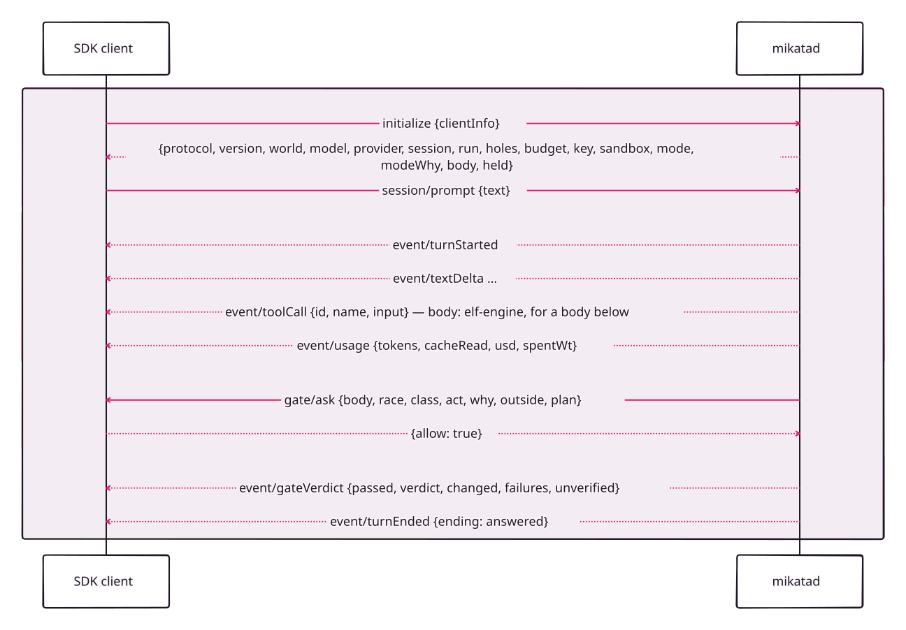
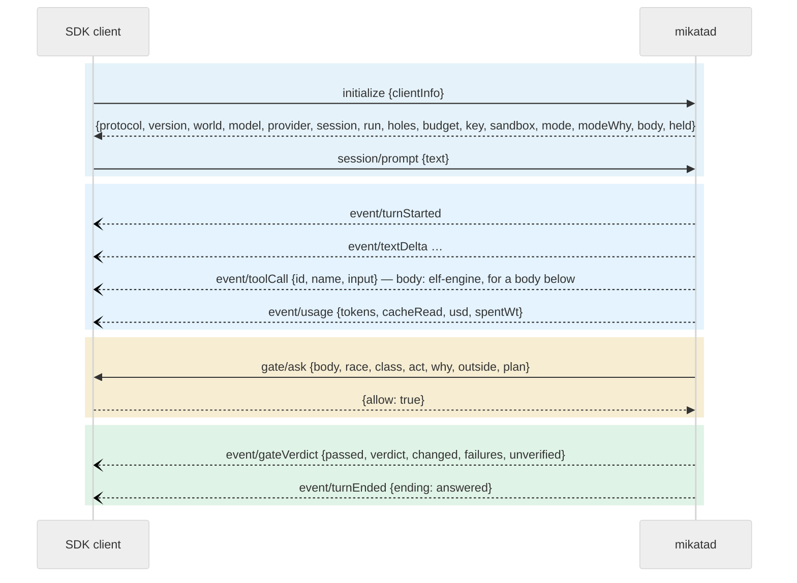

# The client protocol

How programs that are not Rust talk to Mikata: the TypeScript SDK, an editor plugin, the web
board. They all speak one JSON-RPC 2.0 API to `mikatad`.

## In one picture

<a href="./canvas/client-protocol-light.svg">
<picture>
  <source media="(prefers-color-scheme: dark)" srcset="./canvas/client-protocol-dark.svg">
  
</picture>
</a>

The sketch in Mermaid, the text this canvas is drawn from

## In plain words

`mikatad` exposes one JSON-RPC 2.0 API. The TypeScript SDK reaches it over stdio, the board over
a loopback WebSocket. Types are defined in Rust and generated into TypeScript
(`@mikata/protocol`), so the clients cannot drift. The terminal app, `mikata`, needs no wire:
it hosts the session in its own process and draws the same events, made by the same function
(`mikata_server::events`); its gate cards answer the same questions `gate/ask` carries, and
`mikata run --json` prints those events as JSON lines.

A client opens a session, sends an ask, and reads the turn as a stream of events: text, tool
calls, spend, the end gate's verdict. When the body wants to do something that needs you, the
core asks the client (`gate/ask`) and waits; nothing that needs your word runs until a client
says yes, and an unanswered ask is a no.

## Technical detail

| Kind | Served | Planned |
|---|---|---|
| requests (client → core) | `initialize`, `session/prompt`, `session/send`, `session/interrupt`, `session/events {since}`, `shutdown` | `session/resume`, `queue/list`, `queue/move`, `world/status`, `ledger/query`, `config/explain` |
| requests (core → client) | `gate/ask` — the human gate, the only call the core blocks on | |
| events (core → client) | `turnStarted`, `queued`, `textDelta`, `toolStart`, `assistant`, `toolCall`, `toolResult`, `usage`, `note`, `warning`, `gateVerdict`, `changes`, `turnEnded`, `held` | `dispatch`, `report`, `ascension`, `evolution` |

Each message is one line of JSON. `initialize` opens the session and answers `{protocol, version,
world, model, provider, session, run, holes, budget, key, sandbox, mode, modeWhy, body, held}`:
`mode` is `light-coding`, `structured-coding` or `collective-coding`, and `modeWhy` says why the
session opened in it,
in words for the human. A client that speaks another `protocol` stops rather than misread. Each event is the notification `event/<type>`, its fields beside the
envelope. `session/prompt {text}` answers `{queued}` at once: a line sent while a turn runs
waits its turn, and the session takes lines strictly in the order they came. `gate/ask` sends
`{race, class, act, why, outside, plan?}`, and the client answers `{allow, reason?}`. An act an Oni envelope admitted asks nothing: the client is shown it as a `warning` event. `plan` is
the short form of the plan a command's approval binds to
([the sandbox](03-architecture.md#sandbox)); an ask that spawns nothing has none. A `usage` event
carries the turn's tokens, cache reads and writes, its price, and the run's spend and context
against its stress line, for the status line. A `held` event, sent once the session's queued
lines and their wake are done, carries how many orders the shared work queue holds; the hello
carries the same count as the session opens, and the status line reads "N held" while it is not
zero. A `toolResult` carries at most 16 000 bytes and
says how many it cut; the journal keeps the whole.

`mikatad` serves it: `mikatad [--world <dir>] [--mode <mode>]` speaks on stdin and stdout,
opens the session from the world's configuration on `initialize`, in the mode asked for or the
world's own, and answers `--help` and `--version`
before it looks for any world. Inside, one thread owns the output, so no two lines interleave or
reorder; one thread reads the input and answers the gate's waits itself, so a gate holding a
turn never blocks the read that would release it; and one task owns the session.

The clients reach it through two packages. `@mikata/protocol` is the protocol's types,
generated from the Rust (`ts-rs`) into `src/generated` and checked in: the check regenerates them
and fails when they drift, and a test holds the TypeScript `PROTOCOL` to the core's. `@mikata/sdk`
is the client: `stdio()` starts `mikatad` and speaks on its pipes; a `Client` sends typed
requests, refuses a core that speaks another protocol, delivers every event to its listeners in
order and once each (`resync()` replays from the last `seq` it saw, dropping what it already
had), answers `gate/ask` with the handler the interface gives it — denying when there is none —
and fails whatever waits when the core's end closes, with the reason the core gave. `ws()` (from `@mikata/sdk/browser`, which leaves Node
out) is the board's transport: it reconnects, and the client then takes control back if it had it
and replays from the last `seq`, holding live events until the replay is done.

**The terminal client.** `mikata` opens a session in this world, hosted in its own process,
and draws it in the terminal ([the terminal UI](03-architecture.md#the-terminal-ui)); `mikata
run "<ask>"` asks once without the app, prints the answer on stdout and the calls and the ending
on stderr, and exits 0 only when the body answered and the end gate passed
([`mikata run`](03-architecture.md#mikata-run)). `run` reads its ask from stdin only when none
is on the command line (`run` or `run -`) and stdin is no terminal, and it asks no one: an act that
needs the human is denied, and the denial says so, unless `--gate-tty` puts it to them on the
terminal. `--help` and `--version` answer before any world is looked for; a session that will not
open says why in plain text before the terminal is taken. The app shows the transcript — the text
as it streams, the calls that run with their cards and diffs, the lines waiting their turn, an
approval when one is asked — beside a sidebar of vitals, memory, files and bodies, over the input
and the status line: model, spend (`unpriced` when the price tables do not know the model),
context against the stress line, the cache's share, and what the human's caps leave
([consumption](05-consumption.md)). A tool call shows as soon as it starts, before its input has
streamed. **`mikata status`** prints the build's version, the world, the model and its
provider, where the provider's key comes from (its variable and the file that names it, never the
value), the sandbox actually in force (or `none — <reason>`), what the caps leave, the
configuration's holes, and each living creature's meters on one line — each with its count and
its 95% interval, or `no reports` where no fold reads it yet
([meters](experimental/races.md#ascension--earned-granted-revocable)), and the last run's acts counted per
[guts class](02-loop.md#stress-in-four-instruments), printed even when no session opens. **`mikatad onto owner <path>...`** asks the core who owns each path, by
which rule and claim ([ontology](experimental/ontology.md#ownership-one-function)), with no session and no
key. **Enter** sends, and while a turn runs the line waits its turn; **Alt+Enter** starts a new
line; **`/send <text>`** steers the turn that runs, the text reaching the body after its next tool
step as the human's; **Esc** stops the turn; **Ctrl+C** stops the turn, or quits when nothing
runs; **↑ ↓** walk the history. An approval is chosen with **1** (**y**), **2** (**n**) or **3**
(no, with a reason) and confirmed with **Enter**, so a key typed as the card appears approves
nothing; one whose turn ended unanswered is denied and cleared. The cursor moves by whole
characters, an emoji as one.

Rules:

- Every event carries `{session, run, body, seq}`; `seq` rises by one, in the order events reach
  the wire, so a client that reconnects asks `session/events {since: seq}` and loses nothing. The
  core keeps the last 10 000: the answer says the oldest it kept (`oldest`), and `complete: false`
  when the client asked from further back, so a gap is never silent. The board's bridge answers the same
  request in pages, `more: true` while another follows; the core answers all it keeps
  (`more: false`).
- An event from a body the session commissioned carries that body and its run, at any depth: the
  client sees the whole order at work. The terminal shows such events as short lines under the
  body's name — what it started on, each tool call, a gate that refused it, how it ended — and
  never lets them touch the session's own turn; the hello names the session's own body, so even a
  replay that opens mid-commission tells them apart. An approval names the body asking, and a
  body's dollars below count in the session's spend.
- Leaving ends everything at once: on `shutdown`, or when the client's end closes, every act
  waiting at the gate is denied, the turn in flight stops, lines still queued never run, and the
  core exits once its output is written. Esc (`session/interrupt`) denies an act waiting at the
  gate as part of the turn it stops.
- One message per line; a batch is refused by name, and a notification is never answered.
- An unanswered gate never allows. After 10 minutes the act is denied and the body is told the
  human did not answer. Planned, with no milestone: the run checkpoints as `SUSPENDED` instead (a
  neutral word: no strain, no failure) and resumes at that act when the human answers — an
  overnight run waits instead of dying.
- The board carries this protocol over `WS /ws/session/<id>`, a child `mikatad` per chat
  ([the chat bridge](03-architecture.md#the-chat-bridge)): its Host and Origin are checked, the
  cookie traded for the printed key and the CSRF token are required, and the bridge adds
  `board/role`, `board/askGone`, `board/refused`, `board/ended` and `board/oversize`, `leftMs` on a
  `gate/ask` sent again, and `board/takeOver` from a tab.
- Protocol changes are versioned; the generated TypeScript is checked in and CI fails on a diff.
