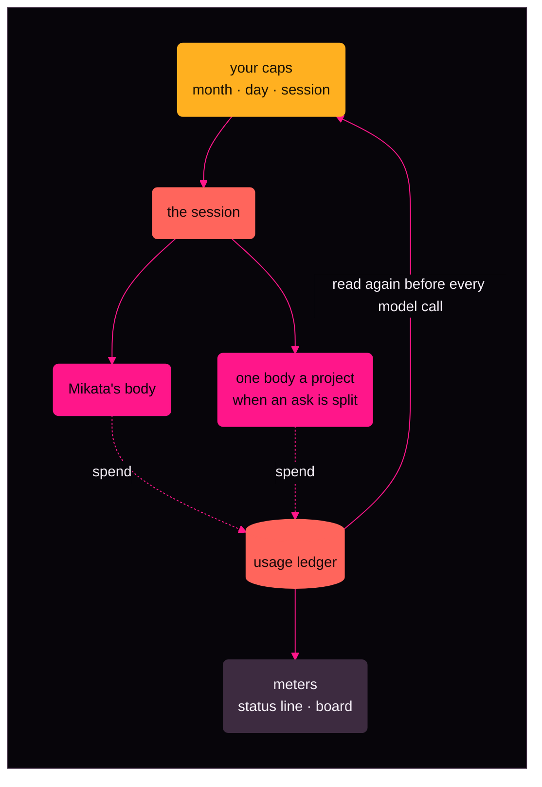

# Consumption

## In one picture



## In plain words

You set caps: per month, per day, per session. Before every model call, Mikata reads the usage
ledger again and checks that the call fits under every cap. If it does not, Mikata stops cleanly
at a checkpoint you can resume, rather than overspend. When an ask is split by project, every
project's agent reads the same ledger and stops at the same caps.

Every model call writes one line to the usage ledger: who spent it, on which model, how much was
cached. The terminal app and the board show it live: tokens, cost, cache hits, what is left.

The biggest saving is designed in, not bolted on: every prompt is laid out so its start never
changes between calls, which lets the provider's prompt cache serve most of it at a fraction of
the price.

In [the lab's](experimental/) modes, budget also flows down a chain of agents, each order carrying
a slice of its giver's ([how it is carved](experimental/the-lab-in-the-code.md#carving-the-budget-down-a-chain)).

## Technical detail

### The usage row

One JSON line per model call in `.mikata/instruments/usage.jsonl` — decisions included: a
System One read writes its own row under its provider, with `usd` null for a model the price
tables do not know, so its `wt` still reaches the meters and the budget:

```json
{"ts":"2026-10-23T19:07:00Z","session":"…","run":"…","body":"summoner","race":"summoner",
 "model":"…","provider":"anthropic","input":5580,"output":112,
 "cacheRead":4096,"cacheWrite":0,"prefix":3900,"wt":6700,"usd":0.0041,
 "envelope":{"left":54888,"of":60000}}
```

(`body` and `race` say whose call it was: Mikata's own body is `summoner` inside the code. A row
from a lab body also names its `commission`.)

When the provider reports what it charged for the call — OpenRouter's `usage.cost`, a number of
dollars, `0` on a free model — the row keeps it as `reportedCost`, beside `usd`, Mikata's own
estimate from its price tables; neither replaces the other. A provider that reports none leaves
the field out. A server that reports no usage at all (Ollama when `stream_options` is not sent) leaves
the call's tokens unknown: the client estimates them at their worst from the bytes sent and
answered (about four bytes a token), the row says `"estimated":true`, its `wt` weighs the
estimate, so the envelope and the budget are charged, and `usd` is null — unpriced, never a free
call. The answer carries a warning saying so.

Behind a router the row also names the host that served the call, as `upstream` — OpenRouter's
`provider` on each streamed chunk, kept to a short name of plain characters. The same model
served by two hosts can differ in its cache and its latency, so a comparison of two arms reads
this before it trusts a cost bar. A provider that names no host leaves the field out.

A call that is no body's turn says what it was for in `purpose`: `rerank` for the MCP shortlist's
fast-tier call, `rerank (timed out, estimated)` for one that gave no answer in time and is
ledgered at its worst case; a body's turn carries none.

`prefix` is the part of the input that was the fixed per-session prompt (law, body card,
manifests): the cost every turn carries before it does any work, folded on its own
line (`prefixShare`) so a growing law shows up as a number, not a feeling. What the law buys is
measured against what it costs by the bench's law arm: the same tasks run again with
`mikata run --no-law`, which says none of the world's own words ([the bench](https://github.com/Kaginari/mikata/blob/main/bench/README.md)). The journal is
append-only: one row per line, appended and synced before the call returns (a new journal's
directory is synced too). A torn last line is closed before the next row is written, and is
skipped and reported when the journal is read back, never fatal; a byte-order mark is ignored.

**The chain.** The usage ledger is a chained journal (`mikata_ledger::chain`), so an edit of
past spend is found, not believed. Each row carries the chain's fields around its own, in a
fixed order:

```json
{"prev":"<sha-256 hex>","ts":"…","session":"…", … ,"digest":"<sha-256 hex>"}
```

- `digest` is the SHA-256 of every byte of the line before `,"digest"` — the bytes as written,
  never a re-serialisation — and `prev` is the previous row's `digest`. The row's own fields are
  recovered byte for byte, so a reader parses a chained line as it parses a plain one.
- **Genesis.** A journal becomes chained from its first chained row, marked `"genesis":true`,
  whose `prev` is the SHA-256 of every byte the file held before it: rows written before the
  chain read as before, and an edit of them breaks the genesis link.
- **The head** — the newest row's digest — is kept in memory by the writer and found on open by
  walking the file once; another writer's rows are walked on under the file's lock before the
  next row is sealed, so concurrent writers keep the chain linear. Every writer of a chained
  journal chains: an unchained row after the genesis is a break, and reading the journal back
  skips it.
- **A torn last line** (a crash mid-write; it ends without its newline) is a truncation, not
  tampering: the next row closes it, links to the last whole row, and records it as
  `"torn":<line>`. Only a partial line is ever torn: a line that is whole JSON breaks the chain at
  once, whatever comes after it.
- **The head is anchored outside the file**: by `mikatad housekeep --verify`, in `log.md` and
  in a copy under the human's state directory (`$XDG_STATE_HOME/mikata/anchors/<world>-<fnv64a>.jsonl`),
  out of every command's reach; and in the handoff when light-coding escalates (and the run's
  journal beside it) — in the lab, also in an ascension, probation or fall entry. Dropping the last rows,
  or stripping the chain's fields and rooting it again, leaves a chain whose links hold; the walk
  is held to the newest kept head (the state directory's, else `log.md`'s), which must still be a
  row at its line or later, or the chain breaks at the anchor. A walk that does not hold anchors no
  new head.
- **`mikatad housekeep --verify`** walks each chained journal once and says, escaped: OK with
  the head, a truncation with the head the chain holds to, or the first broken link with its line
  and why (an edited row, a removed or inserted one, a line no row recorded torn, a lost genesis,
  a kept head the chain no longer holds), and whether `log.md`'s newest anchor and the state
  directory's disagree (`mikata_world::chains::verify`).
- **The tripwire** puts the usage ledger back after each command from what it held plus what its
  witness (`$XDG_STATE_HOME/mikata/usage/<world>-<fnv64a>.jsonl`, every byte the harness
  appended, written there first) gained meanwhile: a command's edit is undone, and a parallel
  run's rows are kept.

Every trust journal is chained, walked and anchored (`mikata_world::chains::journals`): the
usage ledger, the end gate's verdicts, the acts' guts classes, the Minds' witness and the verify
pins — and the lab's own ([the lab in the code](experimental/the-lab-in-the-code.md#the-labs-storage)). Where each lives is
in the [storage table](03-architecture.md#storage-files-are-the-truth).

Two meters, one implementation each, never confused:

- **occupancy** — how full the window was at the last call: that call's `input + cacheRead +
  cacheWrite`. A reading, not a sum; the stress zone reads it.
- **spend** — every class of every call, summed. Budgets and caps read it, in weighted tokens.

Prices are `[models."<id>"]` tables in TOML — `input`, `output`, `cache-read` and `cache-write`,
all four required, in dollars per million tokens — layered model by model from the binary's table
and config (a config row replaces the whole row). The cache prices are never derived from the
input price: the read multiple differs by model, a tenth on some and a twentieth or less on the
newest. Mikata marks only 5-minute cache breakpoints; a reply that reports 1-hour cache writes
(priced at 2× input) carries a warning on its response, since the ledger prices every write at the
5-minute rate. A missing or misspelt key or a negative price refuses the table. A model with no
price records `usd: null` and the meter says *unpriced*, never zero; its weighted tokens still
count, with an output ratio of 5.

The binary ships one table per provider, from the provider's published prices — never guessed.
Anthropic's (`crates/mikata-provider/prices/anthropic.toml`) prices Claude Opus 5.5, Claude
Sonnet 5.5 and Claude Fable 5.1; a model whose four prices are not all published, such as Claude
Haiku 5.5's cache prices, stays unpriced until they are.

### The build on value rows

Every row the value ledger folds carries the build
that wrote it, as `build: { version, commit }`: the crate version and the commit `status` prints,
from one source (`mikata_ledger::Build::this`, stamped at build time; a tree with uncommitted
changes to tracked files stamps its commit `-dirty`, and a build without git `unknown`). The
evolution ledger's swap and run rows carry it the same way, and M11's ascension rows will. A row written before rows were stamped reads as `unknown`.
The row is written whole, in one write, stamp included. A fold groups or filters by build, so a
replay can tell a rate earned under old gate rules from one earned under new; the scoring reads
every build alike.

### The unit: weighted tokens

A budget counts what a call really costs, not how long its context is. Re-sent context served
from the cache costs about a tenth of fresh input (less on the newest models), so counting raw
context would kill a body after a few calls while
it was spending almost nothing. The unit is the **weighted token** (wt):

```
wt = uncached_input + 1.25 × cache_write + c × cache_read + r × output
```

where `r` is the model's output-to-input price ratio from the price table (5 when the model is
unpriced, or priced with free output — output is never free in weighted tokens), and `c` its
cache-read-to-input ratio (0.1 when the model is unpriced or its input is free). The cache-read
weight is the model's own because models bill a cache read very differently: a tenth of input
on some, a third on qwen3.5 through OpenRouter ($0.05 against $0.15). At a fixed tenth, a run
that reads most of its context from the cache weighed a third of what it cost, so a cost bar in
wt misjudged a lever against one that cached less. Dollars stay the exact view, and levers are
judged in them. It is computed in integers, each ratio to a thousandth, and rounded up.
Currency caps convert through the same table; a model with no known price is still bounded in wt.

### Envelopes

- **Caps:** `budget.session`, `budget.day`, `budget.month`, in weighted tokens, from the human's
  own files only — a cloned repository neither raises nor sets one. They are per world: the
  day and the month are read from the world's usage ledger, so they hold across the sessions
  that share it (a ledger across worlds comes with the board, M12). Before every model call the
  run rereads the ledger and stops at a checkpoint (`budget: the day cap is spent — …`) once the
  session, the day or the month is spent; at 80% of one the human is warned, once. A call is
  never cut in half, so a run can pass a cap by the one call that crosses it; every call — the
  salvage turn after a clock death included — is metered and ledgered. A ledger that cannot be
  read opens no capped session and stops a capped run: spend it cannot see is spend it cannot
  stop. A line it cannot read — a torn last write after a crash, a hand edit — is counted high, as
  the largest call the ledger knows (20 000 wt at least), against every cap, since it cannot say
  its day or its session; against each cap it weighs at most a hidden reserve of 15% of the cap,
  so by itself it never stops a session, and with real spend it brings the stop that much nearer.
  The session opens telling the human which lines to repair or remove to count them true. Weighted tokens count every call — priced, unpriced or free — so no model slips under a
  cap; a dollar cap could not promise that, and the dollar keys (`budget.*_usd`) are a view for
  the board (M12), never a limit.
- **A budget refusal is explained** (`BudgetShort::refusal`, `Shortfall`): it names what is
  needed, what is left, the least top-up that lets it fit, and where the top-up comes from — the
  human's cap that sets what is left, raised under `budget.session`, `budget.day` or
  `budget.month` (in the lab, or the commander that carved the envelope):
  `refused: needs 41k wt, 12k left this session; top up >= 29k wt (budget.session)`. From ten thousand up, weighted tokens read in
  thousands — the need and the top-up rounded up, what is left rounded down — so the top-up named
  always suffices.
- **Spend is recorded, never refused after the fact.** Pre-flight is the guard; when a call
  costs more than its estimate, the real cost is booked and the envelope reads *overspent*.
### Cache-first prompt layout

The provider renders tools, then the system prompt, then the messages. Changing any tool
definition invalidates everything after it, so the tools tier comes first and never varies.
Anthropic allows at most four cache breakpoints. Most of a long run's input is its
conversation, not its prompt, so one breakpoint always rides the conversation's tail:

```
[ tools: the full, stable tool list       ]  ← identical for every session:         breakpoint 1
[ crest + nature law                       ]  ← identical for every session:         breakpoint 2
[ body card + its rules + Minds            ]  ← identical across its turns:          breakpoint 3
[ recall anchors · toolbox manifest text · conversation ]
                                              ← the last block sent:                breakpoint 4
```

- The conversation's breakpoint moves forward every turn, so each request reads everything the
  last one sent at the cache-read price and writes only what the turn added. The conversation
  takes the slots the stable tiers leave, the tail first; a spare slot marks the previous
  request's tail too, so a turn that appends many blocks still lands within the provider's
  lookback of the entry the last one wrote.
- Compaction rewrites the conversation from its first folded message on, so it folds only in
  rare, large batches ([The loop](02-loop.md)): between folds, the history is read, not resent.
- Every request only appends to the one before, between folds. The system prompt and the tools
  are built once, when the run is made, and sent byte-identical for the whole session. Anything
  that changes mid-session rides as a new message, never a rebuilt prefix:
  - the model falling back, the date, the working directory, the mode or a reloaded
    configuration is a `[context update]` line appended before the next request
    (`Run::update`, `Run::switch_model`; a new model changes only the request's model field);
  - a Mind worn is the `wear` call's result;
  - the toolbox manifest, the journal's opening, recall and the ontology ride in the ask's own
    message;
  - a steering line, a gate failure handed back and a stress warning are notes appended after
    the turn's results;
  - the summary, drain and salvage turns send the tools as any turn does, and tell the body in
    words to call none.
- The run checks the prefix each turn: the system prompt and the tools, then the conversation
  block by block, its moving breakpoints aside. A fold or a compaction may rewrite what was sent,
  and a `prefix` beat in the journal records where the prefix moved and why. A rewrite with
  nothing to explain it is a bug:
  - it is said in a warning and a `prefix` beat (`unexplained`), in every build, and the run goes
    on;
  - once a session, the run strips every thinking block from what it sends, the turn in flight's
    included. Under preserved thinking an edit invalidates every thinking block after it, and a
    request that still carries one is refused. The provider rebuilds its cache from there
    anyway, so it is rebuilt smaller.
  - tool calls and words stay; a turn that held only thinking says "(reasoning omitted)", so no
    turn vanishes. The journal keeps everything.
- Behind an OpenAI-compatible gateway, Claude caches only what is marked: the request carries
  the gateway's one automatic breakpoint, which moves with the conversation. The other models
  there (OpenAI, DeepSeek, Gemini, Grok, …) cache a stable prefix on their own.
- A router sends one model's calls to several hosts, and a host's prompt cache is its own: a call
  that lands on another host pays for the whole context again, and some hosts cache nothing. In
  one screen of 1,496 calls to one model, one host served 89% of its prompt tokens from cache
  and two others 0%, and the same task cost $1.36 to $1.47 on those two against $0.51 to $0.58
  on the first. `providers.<name>.upstreams`, in the human's global file alone, names the only
  hosts the router may use, by the router's own slugs; the request then carries OpenRouter's
  `provider.only`. One host named is a pin: a call it cannot serve fails and goes nowhere else.
  Unset, requests are byte-identical to before and the router chooses.
  - **Which hosts cache, probed** (11 November 2026, `qwen/qwen3.5-35b-a3b` through OpenRouter):
    the same request of about 8,200 prompt tokens sent twice, six seconds apart, to one pinned
    host, once with no cache mark and once with `cache_control` on its long system block.

    | Host | Second call read from cache, no mark | With a cache mark |
    |---|---|---|
    | Venice | 90% | 90% |
    | Parasail | 0% | 0% |
    | Alibaba | 0% | 0% |

    So on this model a cache mark changes nothing, Venice caches on its own, and the other two
    do not cache at all, whatever the router's listing says: it lists Parasail as caching. A
    host's behaviour is its own and can change; the probe is cents, and is worth repeating
    before a campaign whose arms are compared in dollars.
- **A note's place matters to the cache.** A host that keeps a model's reasoning only for the
  turns after the last user message drops all of it when a note arrives as a user message.
  Probed the same day on Venice, on one conversation with about 7,200 tokens of reasoning in
  its assistant turns:

  | Sent | Prompt tokens | Read from cache |
  |---|---|---|
  | The conversation, repeated | 29,005 | 98% |
  | The same, with a note as a new user message | 21,807 | 0% |
  | The same, with the note appended to the last tool result | 29,033 | 98% |

  The loop still sends its notes as user messages: where a note is put changes what the model
  is told, and is a decision of its own. `mikatad runs --session` counts what it costs today
  ([The loop](02-loop.md)).

- The toolbox's level-1 manifest is **text** in the changing tail, never tool definitions — so
  offering different tools per turn never breaks the cache.
- A test runs a session of eight turns through a steering line, a Mind worn, a model fallback,
  a reloaded configuration and a fold. It asserts the system prompt and the tool JSON are
  byte-identical in every request, and that each request only appends to the one before except
  at the fold. Any timestamp, map ordering or counter that leaks into the stable prefix fails CI.
- Each provider and model has a minimum cacheable prefix; a test asserts each breakpoint's
  prefix meets the minimum of every configured model, or the breakpoint is merged into the next.
- Caches are per model: "identical for every body" pays off among bodies on the same model.
- `cacheHitRate` is a signal in the value ledger, per tier; the board shows it per model and body.

### MCP tool schemas

An MCP tool's schema would ride every request of a run that carried it, so none does: a run
carries four fixed doors, and MCP reaches a body in three levels, each priced before it loads
([MCP](06-mcp.md#three-levels-priced)):

- level 0 — one line per server, with the weighted tokens of opening it — rides the first ask's
  uncached tail, and `mikata status` shows the same lines;
- level 1 — a server's tools, each with the price of its schema — and level 2 — one schema — are
  tool results, loaded only when the body asks, at the price the level above showed: the bytes of
  exactly that text at four a token;
- the tools ranked for an ask are named at level 1 in its tail, so the right tool is usually in
  view without a search turn;
- when the catalog is large and the top scores sit close, one fast-tier call reranks the
  shortlist: a usage ledger row like any call, its cost said in the run's journal, and kept for
  the session so the same ask never pays twice ([MCP](06-mcp.md#reranked-by-the-fast-tier));
- the tools block never changes mid-run, so the doors are read from the cache at the cache-read
  price after the first request, and every loaded level is in the usage ledger's input like any
  other tool result;
- a body's habitual tools — chosen once, when the session starts, from the MCP journal — ride
  its frame up front, within what the prefix ceiling leaves; a server whose schemas
  together pass the ceiling stays at level 0, and a level whose price passes the run's envelope
  is refused before it loads ([MCP](06-mcp.md#budgeted));
- on Anthropic, every other tool in scope is a native deferred tool: sent, but out of the context
  and the cached prefix until level 2 references it ([MCP](06-mcp.md#native-deferred-tools)).

### Reads by range

File reads are the largest class of tokens a body spends: a file read whole is paid for when it
is read, then again at the cache-read price on every later turn until a fold takes it out. So a
body reads a skeleton first and then only the lines it needs ([the tools](03-architecture.md)):
`index` gives each symbol's line range, and `read` takes a range or `path#symbol`. A file over
`tools.read.range_over` lines (400) read without a range answers with its skeleton, not its
text. On this repository's `crates/mikata-tools/src/files.rs` (1,293 lines), a whole read is
about 56 KB of numbered lines; its skeleton is under 3 KB, and the one function then read is
a few more. An `index` call is journaled and priced as any read: its result is input like a
read's, and the files it outlines count as what the ask read.

### Meters

| Meter | Reads | Where |
|---|---|---|
| spend | session tokens and cost, per body | status line, board |
| left | envelope left for the active body and the session | status line |
| cache | cache read ÷ input, rolling | status line, board |
| burn | tokens per minute over the last 5 minutes | board |
| per body and model | spend, tokens and cache hit over 7 or 28 days, or all | board, `mikatad usage` |

`mikatad usage [--window 7d|28d|all] [--json]` prints the same folds in the terminal — by race,
model, body, day and session — and the board's metrics are that fold ([the board's
metrics](03-architecture.md#metrics-and-integrations)). A group with no priced call reads
`unpriced`, never $0. A group with calls that carried a provider's own cost also reads
`provider-reported $… (n calls)`, summed over those calls only (`reportedUsd` and `reported` in
`--json`).

### Building Mikata within your plan

The roadmap is cut into rungs small enough to finish in one or two focused sessions each. On a
subscription plan what binds is not money but the usage windows (the 5-hour and weekly limits),
so after every rung the session's **tokens per model** and the **share of the usage window** it
took are read with `npx ccusage` (`daily` and `blocks`, from Claude Code's local logs) and
written to the rung's entry in `log.md`. The dollar figure ccusage prints is the API-equivalent
price, not what the plan costs: it is recorded only as a comparison. From M6 Mikata runs part of
its own work in light-coding, and its own ledger becomes the second instrument.
