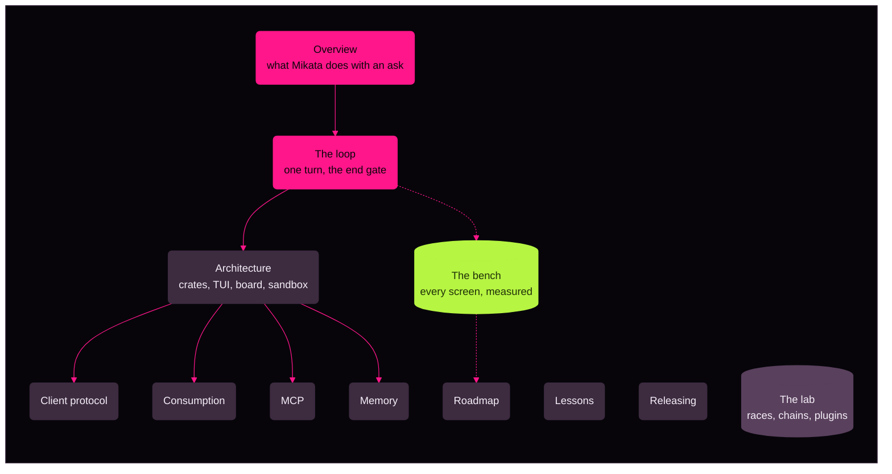

# Mikata — the book

Mikata is a coding agent on your side. You give it an ask; it works in your repository, checks its
own work, and lands nothing until your tests pass. This book says how, exactly as the code does it.

Every chapter reads the same way:

1. **In one picture**, a diagram you can take in at a glance.
2. **In plain words**, the idea without jargon.
3. **Technical detail**, the exact rules, types and numbers.

## In one picture

## Diagrams

Every chapter has at least one, written in Mermaid inside the page, so it renders the same on
GitHub and on the site and changes in review like any text. `node tools/check-diagrams.mjs` fails on
a diagram Mermaid cannot read.

They wear Mikata's colours on a night background, each block filled with its own colour:

| Colour | Means |
|---|---|
| hot pink | Mikata's core |
| plum | a step |
| lime | what checks and passes |
| amber | you |
| coral | what is kept |
| muted plum | what is outside, or later |
| red | what fails or is refused |

Lines are hot pink and corners are rounded; a decision stays a diamond and a store a cylinder.
Charts give each harness its own colour, checked for colour-blind readers: Mikata hot pink
`#ff168a`, Maki amber `#cd7d00`, OpenCode blue `#3986e4`. No emoji: words say what a block is.

## Reading order

| # | Chapter | Read it to learn |
|---|---|---|
| 1 | [Overview](01-overview.md) | what Mikata does with an ask |
| 2 | [The loop](02-loop.md) | one turn from ask to answer, and the end gate |
| 3 | [Architecture](03-architecture.md) | the parts: the terminal app, the board, the sandbox, configuration |
| 4 | [The client protocol](04-protocol.md) | how programs talk to Mikata |
| 5 | [Consumption](05-consumption.md) | how spending is budgeted, metered and stopped |
| 6 | [MCP](06-mcp.md) | connecting MCP servers, and paying only for what is used |
| 7 | [Memory](07-memory.md) | what Mikata remembers, and why only checked work is kept |
| — | [The bench](bench.md) | every measurement against OpenCode and Maki, with its method |
| — | [Roadmap](roadmap.md) | what comes next |
| — | [Lessons](lessons.md) | what we learned, each one now a test or a rule |
| — | [Releasing](releasing.md) | how a version is built, checked and published |

## The lab

Before it was Mikata, it was **Mnemorph**: a kingdom of races, a chain of agents handing work down,
and a collective of equals. They still run, behind `--mode`, and they are frozen: one agent per
project did better on every measurement. [The lab](experimental/) keeps them:
[the modes](experimental/modes.md), [the races](experimental/races.md),
[how agents talk](experimental/communication.md), [the ontology](experimental/ontology.md),
[plugins](experimental/plugins.md), and [how it was built](experimental/roadmap-m0-m14.md).

## Three words

- **World**: the repository Mikata works in, with its folder `.mikata/`: the journal, the ledgers,
  memory, your local config. Sessions forget; the world remembers.
- **Body**: one running agent, made of the model, its prompt and its tools, for one ask. It ends
  with the ask; only what it wrote to the world remains. Mikata is the body you talk to.
- **Gate**: what stands between a body and your repository: the sandbox around every command,
  your approval on every act that leaves your machine, and the end gate on every change.
