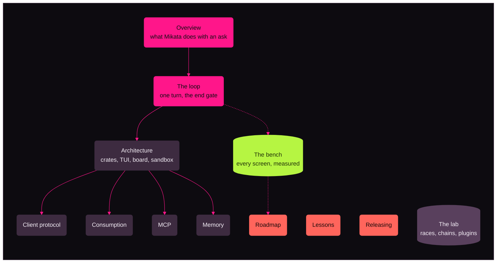

# Mikata — the book

Mikata is a coding agent: a Rust core and terminal app, `mikata`, a server, `mikatad`, for the
TypeScript SDK and the web board, and one body that works over your repository, held to an end
gate and to every line of "done" you write down. This book says exactly what the code does.

Every page reads the same way:

1. **In one picture** — a diagram you can understand in a minute.
2. **In plain words** — the idea, without jargon.
3. **Technical detail** — the exact rules, types and numbers the code implements.

## In one picture

## Diagrams

Every page has at least one, written as Mermaid in the page's text: it renders on GitHub as in
the book, diffs in review, and is checked by `node tools/check-diagrams.mjs` (in `just docs` and
CI), which fails on a diagram Mermaid cannot parse. Numbers the book reports are charted as
`xychart-beta`, one measure a chart (never two scales on one), its table beside it as the table
view.

They wear Mikata's design system, the same on GitHub as in the book: each block's front matter
carries the palette (`theme: base`), and the whole diagram sits on the night background. A block
is filled with its border's colour and its words are set to read on it: hot pink for Mikata's
core, plum for a step, lime for what checks and passes, amber for you, coral for what is kept,
muted plum for what is outside. Corners are rounded; a decision stays a diamond and a store a
cylinder. Lines are hot pink. In a chart each harness keeps its colour: Mikata hot `#ff168a`,
Maki amber `#cd7d00`, OpenCode blue `#3986e4`, checked apart for colour-blind readers. No emoji in
a diagram: words say what a block is.

## Reading order

| # | Page | Read it to learn |
|---|---|---|
| 1 | [Overview](01-overview.md) | what Mikata does with an ask, the split by project, the processes |
| 2 | [The loop](02-loop.md) | one turn, budgets, the stress instruments, resume, the verify pins, the end gate |
| 3 | [Architecture](03-architecture.md) | crates, the terminal UI, the board, storage, sandbox, configuration |
| 4 | [The client protocol](04-protocol.md) | how the SDK and the board speak to `mikatad` |
| 5 | [Consumption](05-consumption.md) | how every token is budgeted, metered and stopped |
| 6 | [MCP](06-mcp.md) | MCP servers from your config, scoped, ranked, priced and learned; only the needed specs out |
| 7 | [Memory](07-memory.md) | the archive and the traces, recall with a seat for dissent, why only the gate writes memory |
| — | [The bench](bench.md) | what we measured against OpenCode and Maki, how, and every screen since |
| — | [Roadmap](roadmap.md) | what comes next |
| — | [Lessons](lessons.md) | what isekai and our own bench taught us, each one a test or a rule |
| — | [Releasing](releasing.md) | how a version is tagged, built, smoke-tested, drafted and published |

## The lab

[Experimental](experimental/) holds what Mikata was as **Mnemorph**: a kingdom of races, a chain of
bodies that hand work down (structured-coding), and a collective of equals (collective-coding).
They still run, behind `--mode`, and are frozen: one body a project did better on every screen.
Their pages are there: [the modes](experimental/modes.md), [the races](experimental/races.md),
[communication between bodies](experimental/communication.md), [the ontology](experimental/ontology.md),
[plugins: every part a unit](experimental/plugins.md),
and [how it was all built, M0 to M14](experimental/roadmap-m0-m14.md).

## Three words

- **World** — the repository Mikata works in, and its folder `.mikata/`: the journal `log.md`, the
  ledgers, memory, your config. Sessions forget; the world remembers.
- **Body** — one running context: the model, its prompt and its tools, for one ask. It dies with
  the ask. Only what it wrote to the world survives it.
- **Gate** — what stands between a body and your repository: the sandbox on every command, your
  word on an act a guard rule says to ask about, and the end gate on every change.
