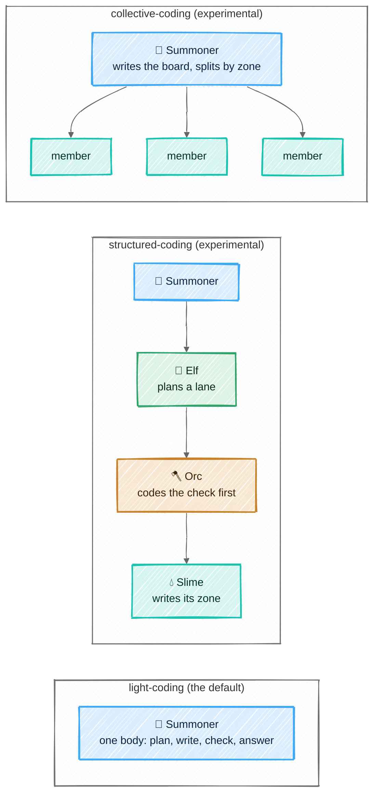

# Experimental modes

Light-coding is the product: one body that writes down what "done" means, does the work and
checks it. This page is the other two modes, **structured-coding** and **collective-coding**.
They are our lab. They work, they are tested, you can use them, and on our bench they have not yet
beaten one body. Each section says what the mode is, what it costs, and what we are building next.

## In one picture

## In plain words

### Structured-coding: the fun part

For work too large for one head, the Summoner hands it down a chain of races. Each race has one job
and **only the tools of that job, enforced by the compiler, not asked for in a prompt**:

- the **Elf** plans a lane and splits it by domain;
- the **Orc** owns a domain and codes the check that will judge the code *before* the code exists;
- the **Slime** is the only one who may change the code of its own small zone.

They share the work board (`.mnemorph/tmp/board.md`), carry the same "done" list down, and report
one mark per line, read from the checks, never from what a body claimed. It is the most
interesting thing in the harness, and the most expensive.

**What it costs today.** Counted only after the fix each screen called for, light-coding did as
much or more for a fraction of the price on work that fits one context
([the numbers](bench.md#the-modes-against-each-other)). Asked to fix five whole repositories at
once: structured-coding 3, 4 and 3 of 5 (17 to 40 minutes, $2.36 a run on average); light-coding
as shipped 3 and 2 of 5 (about 12 minutes, $0.75), and with 400 steps 4 and 3 of 5 (about $1).
More than the default, less than one body given room, at about three times the price.

**Why, as measured.** Each screen found a different cause, and each one we could fix is fixed:

| Screen | What held the chain back | Status |
|---|---|---|
| Multi-part fixes | every body re-read the same files, cold | the work board, carried in every brief; not measured since |
| A two-part fix | a part could not land until the whole ask passed, so no part ever landed | fixed in the gate: a named line red before the landing stays open, the part lands |
| Thirty small projects | tool frictions (a textual null, a folder given to `index`, checks lumped as one bench) | fixed; 28 of 30 since |
| Five whole repositories | the Elf's plan: one project at a time, every Orc given every project's lines, its plan at a guessed path, the work split by layer across folders | the harness hands the lane out by domain before the Elf's first turn (PR #436): 3, 4 and 3 of 5 since |

**The harness splits the lane, not the model.** Four runs broke on four different plans by the
Elf, each a new mistake. The harness already knows each Orc's domain, so when an Elf's ask names
the domains of two or more of its Orcs, the harness starts each on its own domain's work, with the
lines that name it, before the Elf's first turn. The Elf reads their reports and sends failures
back. Measured on the same task: it fired in all three runs, every Orc within seconds.

**What is next: checks that can fail.** The misses since are parts whose Orc wrote a check too
weak to catch them: one only printed its result, one tested another query and asserted the wrong
answer. They came back PASS. A check that passes before any change proves nothing new, and the
gate already runs lines before a landing: such a PASS can be said as "held, not shown".

### Collective-coding: the research mode

Today: the creatures that report to the Summoner are equals. The Summoner writes the work board,
splits the ask by zone and summons the members it needs, which work at the same time; it writes no
code itself. Measured once against light-coding on multi-part fixes: 1 of 4 at $2.02 a run,
against 3 of 8 at $0.62. Splitting work that fits one head only adds hand-offs.

**What we want it to become: many paths, one gate.** A proposal, not built. Light-coding already
weighs two or three ways before it starts, then keeps one. The collective would run several:

1. The Summoner writes the "done" list and three to five genuinely different paths.
2. Each member gets the same ask, the same list and **one path**, in its own copy of the
   repository. They run at the same time.
3. Every result goes through the same gate and the same list. The pick is by the checks: most
   lines passing, then fewest files changed, then cheapest. Never by a model's opinion.
4. Everything is kept: each path's tree, journal, marks and cost.

It costs several times more. In return: a better answer when the first idea is wrong (the prose
asks on our bench fail on one misreading, and different paths force different readings); a signal
when paths pass their own checks but disagree, which means the ask is ambiguous and it is time to
ask you; and data on which approaches work, which is what a learned judge of progress needs.

It pays only if it beats the plain alternative at the same budget: three independent light-coding
runs, best of three by the checks. If it does not, the paths add nothing over sampling, and we
will say so here.

## Technical detail

### Starting them

| Mode | Start it | It needs |
|---|---|---|
| structured-coding | `mnemorph`, in a world where an adopted Elf reports to Summoner; or `--mode structured-coding` | adopted creature cards: an Elf under `summoner`, its Orcs, their Slimes with verify lines |
| collective-coding | `mnemorph --mode collective-coding`; or `collective.on = true` in your global config | at least one adopted creature that reports to `summoner` |

A mode the world cannot give opens no session: it is refused with what is missing, before any key
is asked for. `mnemorph status` says the mode and why. The rest is in the
[overview](01-overview.md#which-mode-and-how-to-start-it).

### What carries over to light-coding

The chain's ideas did not stay in the chain. Light-coding is one body that keeps their rules:

| From | Rule | In light-coding |
|---|---|---|
| Elf | plan before work, weigh paths | `## Paths` and `## Chosen` in `.mnemorph/tmp/plan.md`, before any code |
| Orc | the check exists before the code | the `## Done when` list, `D1`, `D2`…, written first |
| Slime | change only what you own, checked on landing | the end gate on every changed file, tests intact, no seal |
| Kijin | only one race reaches outside, and only through you | nothing outward at all: its shelf is read and write |

### Where to read more

- The races, their tools and limits: [races](02-races.md).
- One order down the chain and back: [communication](04-communication.md).
- Every screen behind these numbers: [the bench](bench.md).
