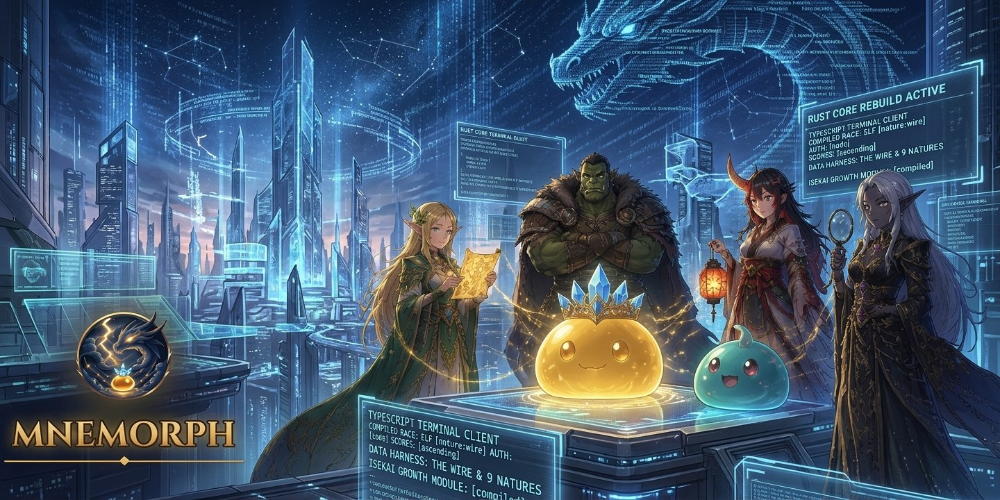
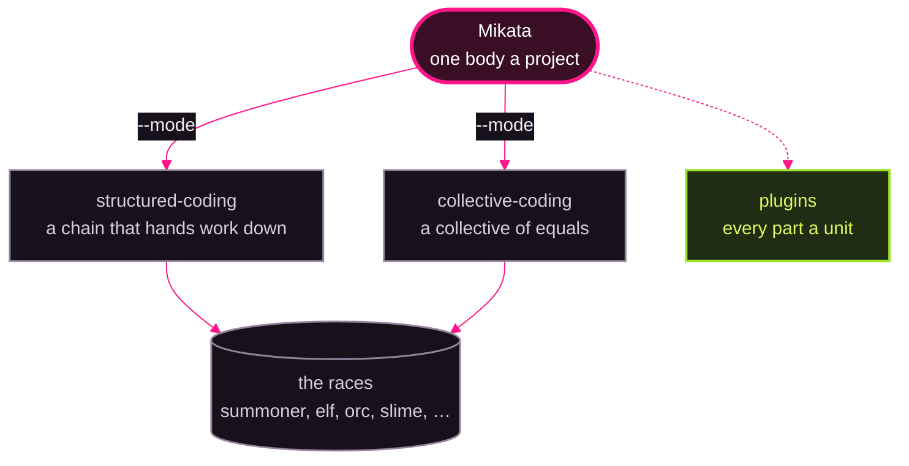

# The lab: Mnemorph

<p align="center"></p>

Before it was Mikata, it was **Mnemorph**: an agent harness grown from
[isekai](https://github.com/Kaginari/isekai), built as a kingdom. Its bodies were **races**, each a
different kind of agent with its own tools, compiled in: what each one may do, whom it answers to,
how it is scored and how it ascends was code, not configuration.

|  |  |  |  |  |  |
|:---:|:---:|:---:|:---:|:---:|:---:|
| **Summoner** | **Elf** | **Orc** | **Slime** | **Kijin** | **Dark Elf** |
| takes your ask | plans a lane | owns a domain, codes the check first | writes the code of its zone | the only hands that reach outside | challenges the code |

## In one picture



## Why it is the lab now

We measured it. On every screen of [the bench](../bench.md), counting only the runs made after the
fix each screen called for, one body that writes down what "done" means and checks it did as much
as the chain of races or more, for less. On the last screen, five whole repositories in one ask,
the chain did 3.3 of 5 at $2.36 a run; one light-coding body a project did 4.5 of 5 at $1.72. What
helped was the split by project, and it moved into Mikata itself. The races' rules live on inside
the one body: write "done" down first, check before you answer, let a gate judge every change.

So Mnemorph's modes are kept, usable and documented, and **frozen**: no new work and no bench runs
on them until there is work where structure should clearly win.

## What is here

| Page | What it holds |
|---|---|
| [The experimental modes](modes.md) | structured-coding and collective-coding: how to start them, what they cost, every screen and why each lost |
| [Races](races.md) | the six races and five ascensions: duties, powers, limits, scores, falls; soil, Kijin posts, the Dark Elf's witness rule |
| [Communication between bodies](communication.md) | the wire envelope, the dispatch rules, one order down the chain and back, the shared queue |
| [Ontology](ontology.md) | who owns each path, facts with who said them, relations between worlds |
| [How it was built: M0 to M14](roadmap-m0-m14.md) | the whole harness, rung by rung, as Mnemorph built it |
| [Race cards brief](race-cards-prompt.md) | the brief for the cards' artwork |
| [Research: DIKWP-MESH](research/dikwp-mesh.md) | the mathematics behind the ontology's outer layer |

## Mnemorph's marks

The emblem, the dragon and the crowned slime, and the banner above are Mnemorph's; Mikata's own
logo is a living cell flowing into a digital one. Mnemorph's files are kept here:

| | |
|---|---|
|  | `assets/mnemorph-icon{,@512,@256,@128,@64,@32}.png`, `mnemorph-favicon.ico` |
|  | `assets/mnemorph-hex{,@64,@32}.png`, the emblem in the races' hexagon |
| | `assets/mnemorph-banner.jpg`, `assets/mnemorph-social-preview.jpg`, and the deck, `assets/mnemorph-deck.html` and its PDF |

## How to run them

```sh
mikata --mode structured-coding    # a world where an adopted Elf reports to the Summoner
mikata --mode collective-coding    # a world with adopted creatures that report to the Summoner
mikatad roster list                # the creature cards here, adopted or not
```

A mode the world cannot give opens no session and says what is missing; it never falls back in
silence. This repository's own `.mikata/` holds a worked example of creature cards.
