# Experimental modes

Light-coding is the product: one body that writes down what "done" means, does the work and
checks it. This page is the other two modes, **structured-coding** and **collective-coding**,
Mnemorph's chain of races and its collective. They are the lab. They work, they are tested, you
can use them, and on our bench neither beat one body. Both are **frozen** since 16 November 2026:
no new work and no bench runs on them until there is work where structure should clearly win.
Each section says what the mode is, what it cost, and where it stopped.

## In one picture

```mermaid
---
config:
  theme: base
  themeVariables:
    darkMode: true
    background: "#0d0b10"
    fontFamily: "Inter, Segoe UI, system-ui, -apple-system, Helvetica, Arial, sans-serif"
    fontSize: "15px"
    primaryColor: "#211824"
    primaryTextColor: "#f5eff7"
    primaryBorderColor: "#ff168a"
    secondaryColor: "#2c2030"
    secondaryTextColor: "#f5eff7"
    secondaryBorderColor: "#ff655c"
    tertiaryColor: "#16111b"
    tertiaryTextColor: "#f5eff7"
    tertiaryBorderColor: "#59405d"
    lineColor: "#ff168a"
    textColor: "#f5eff7"
    titleColor: "#f5eff7"
    edgeLabelBackground: "#16111b"
    clusterBkg: "#16111b"
    clusterBorder: "#59405d"
    noteBkgColor: "#332711"
    noteTextColor: "#ffe1a8"
    noteBorderColor: "#ffb020"
    actorBkg: "#211824"
    actorBorder: "#ff168a"
    actorTextColor: "#f5eff7"
    actorLineColor: "#59405d"
    signalColor: "#ff655c"
    signalTextColor: "#f5eff7"
    labelBoxBkgColor: "#211824"
    labelBoxBorderColor: "#ff168a"
    labelTextColor: "#f5eff7"
    loopTextColor: "#f5eff7"
    activationBkgColor: "#3a0f26"
    activationBorderColor: "#ff168a"
    sequenceNumberColor: "#0d0b10"
    transitionColor: "#ff168a"
    transitionLabelColor: "#f5eff7"
    stateLabelColor: "#f5eff7"
    stateBkg: "#211824"
    labelBackgroundColor: "#16111b"
    compositeBackground: "#16111b"
    compositeTitleBackground: "#211824"
    altBackground: "#16111b"
    specialStateColor: "#b6f542"
    innerEndBackground: "#b6f542"
  flowchart:
    wrappingWidth: 360
---
flowchart TD
    subgraph light["light-coding (the default)"]
      L1["Summoner<br/>one body: plan, write, check, answer"]
    end
    subgraph structured["structured-coding (experimental)"]
      S1["Summoner"] --> S2["Elf<br/>plans a lane"]
      S2 --> S3["Orc<br/>codes the check first"]
      S3 --> S4["Slime<br/>writes its zone"]
    end
    subgraph collective["collective-coding (experimental)"]
      C1["Summoner<br/>writes the board, splits by zone"] --> C2["member"]
      C1 --> C3["member"]
      C1 --> C4["member"]
    end
    classDef throne fill:#3a0f26,stroke:#ff168a,stroke-width:3px,color:#ffffff
    class L1,S1,C1 throne
    classDef elf fill:#0d2419,stroke:#2fa36b,stroke-width:2px,color:#cdf0dc
    class S2 elf
    classDef orc fill:#2a1c0b,stroke:#c9822b,stroke-width:2px,color:#f8e2c4
    class S3 orc
    classDef slime fill:#0b2624,stroke:#19c3b0,stroke-width:2px,color:#c9f6f0
    class S4,C2,C3,C4 slime
```

## In plain words

### Structured-coding: the fun part

> **Frozen, 16 November 2026.** Usable and kept, but not developed or benchmarked further until
> there is work where structure should clearly win. On its last screen, five whole repositories
> in one ask, the chain did 3.3 of 5; light-coding running one body a project did 4.5, for less.
> What helped was the split by project, and it moved into light-coding.

For work too large for one head, the Summoner hands it down a chain of races. Each race has one job
and **only the tools of that job, enforced by the compiler, not asked for in a prompt**:

- the **Elf** plans a lane and splits it by domain;
- the **Orc** owns a domain and codes the check that will judge the code *before* the code exists;
- the **Slime** is the only one who may change the code of its own small zone.

They share the work board (`.mikata/tmp/board.md`), carry the same "done" list down, and report
one mark per line, read from the checks, never from what a body claimed. It is the most
interesting thing in the harness, and the most expensive.

**What it costs today.** Counted only after the fix each screen called for, light-coding did as
much or more for a fraction of the price on work that fits one context
([the numbers](../bench.md#the-modes-against-each-other)). Asked to fix five whole repositories at
once: structured-coding 3, 4 and 3 of 5 (17 to 40 minutes, $2.36 a run on average); light-coding
as shipped 3 and 2 of 5 (about 12 minutes, $0.75), and with 400 steps 4 and 3 of 5 (about $1).
More than the default, less than one body given room, at about three times the price.

**Why, as measured.** Each screen found a different cause, and each one we could fix is fixed:

| Screen | What held the chain back | Status |
|---|---|---|
| Multi-part fixes | every body re-read the same files, cold | the work board, carried in every brief; not measured since |
| A two-part fix | a part could not land until the whole ask passed, so no part ever landed | fixed in the gate: a named line red before the landing stays open, the part lands |
| Thirty small projects | tool frictions (a textual null, a folder given to `index`, checks lumped as one bench) | fixed; 28 of 30 since |
| Five whole repositories | the Elf's plan: one project at a time, every Orc given every project's lines, its plan at a guessed path, the work split by layer across folders | the harness hands the lane out by domain before the Elf's first turn (PR #436): 3, 4 and 3 of 5 since |

**The harness splits the lane, not the model.** Four runs broke on four different plans by the
Elf, each a new mistake. The harness already knows each Orc's domain, so when an Elf's ask names
the domains of two or more of its Orcs, the harness starts each on its own domain's work, with the
lines that name it, before the Elf's first turn. The Elf reads their reports and sends failures
back. Measured on the same task: it fired in all three runs, every Orc within seconds.

**Where it stopped.** The misses since were parts whose Orc wrote a check too weak to catch them:
one only printed its result, one tested another query and asserted the wrong answer. They came
back PASS. That is the next lever if the chain is taken up again: a check that passes before any
change proves nothing new, and could be said as "held, not shown" instead of PASS.

### Collective-coding: the research mode

Today: the creatures that report to the Summoner are equals. The Summoner writes the work board,
splits the ask by zone and summons the members it needs, which work at the same time; it writes no
code itself. Measured once against light-coding on multi-part fixes: 1 of 4 at $2.02 a run,
against 3 of 8 at $0.62. Splitting work that fits one head only adds hand-offs.

**What we asked of it next: many paths, one gate.** Light-coding weighs two or three ways before
it starts, then keeps one. The collective would run several: each member the same ask in its own
copy of the repository, at the same time, and the pick made by the checks, never by a model's
opinion. We said here it would pay only if it beat the plain alternative at the same budget:
three independent light-coding runs, best of three by the checks.

**What a replay of kept runs says of it.** Before building it we took 25 kept runs of the four
prose asks and, by code, asked every run's tree the questions the other runs had asked, with the
real fix as truth ([the bench](../bench.md#what-did-not-help)):

- **Picking is capped by the samples.** Best of three with a perfect picker would pass 0.60 of the
  time, against 0.43 for one run, at three times the price. Where every run misreads the ask the
  same way, no sample holds the right answer; where most do, the majority is wrong.
- **A model settles a disagreement wrongly one time in three.** Shown one case and the answers
  the runs give, two models picked the right one 67% and 63% of the time; on the hardest ask, less
  than half the time.
- **A second reading of what one run changed** catches a limit the ask states and the work
  crossed (57% to 67% of such cases, with 1 to 3% false alarms), and misses a wrong new value. It
  caught 8 and 9 of 16 failed runs, where we had asked for 10.

So the pick is not built: a second head of the same kind shares the first one's reading, and what
the ask leaves out no reader puts back. One thing the replay shows that no bench without a human
can score: where two members' trees contradict each other on a concrete case, the ask is unclear
exactly there. They contradicted each other in every group of two or three on the asks most runs
failed. That case, with its candidate outputs, is a question to put to you, and with examples the
same asks passed 15 of 16.

## Technical detail

### Starting them

| Mode | Start it | It needs |
|---|---|---|
| structured-coding | `mikata`, in a world where an adopted Elf reports to Summoner; or `--mode structured-coding` | adopted creature cards: an Elf under `summoner`, its Orcs, their Slimes with verify lines |
| collective-coding | `mikata --mode collective-coding`; or `collective.on = true` in your global config | at least one adopted creature that reports to `summoner` |

A mode the world cannot give opens no session: it is refused with what is missing, before any key
is asked for. `mikata status` says the mode and why. The rest is in the
[overview](../01-overview.md#the-modes).

### What carries over to light-coding

The chain's ideas did not stay in the chain. Light-coding is one body that keeps their rules:

| From | Rule | In light-coding |
|---|---|---|
| Elf | plan before work, weigh paths | `## Paths` and `## Chosen` in `.mikata/tmp/plan.md`, before any code |
| Orc | the check exists before the code | the `## Done when` list, `D1`, `D2`…, written first |
| Slime | change only what you own, checked on landing | the end gate on every changed file, tests intact, no seal |
| Kijin | only one race reaches outside, and only through you | nothing outward at all: its shelf is read and write |

### Where to read more

- The races, their tools and limits: [races](races.md).
- One order down the chain and back: [communication](communication.md).
- Every screen behind these numbers: [the bench](../bench.md).
