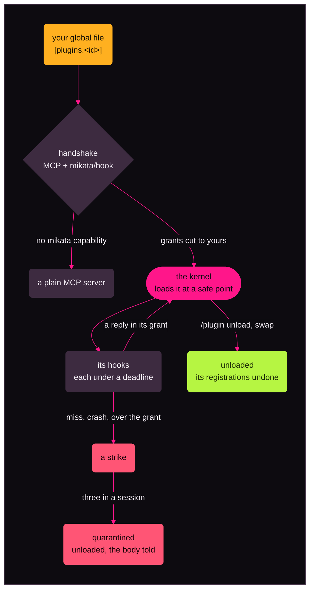

# Plugins: a small loop, every part a unit, swapped while a session runs

Status: **built and merged into `main` as #462 (2026-11-24), experimental**; decided by the owner
on 2026-11-23/24. This page is the plan of record and the contract the kernel was built against;
where it stands is [below](#where-it-stands).

Ground: the analysis in `Kaginari/harness-lab` (`plugin-kernel/`, above all
`designs/design-runtime.txt`), read against Mikata at `b3e42a4`; the Cordis paper
(arXiv 2608.25512) for revertible registrations.

## In one picture

A plugin's life in a session: declared by you, checked at the handshake, run at its hooks under a
deadline, and taken out after three strikes.



## What the owner asked for

1. A small loop; memory, tools, the gate, the `Done when` list, what-changed and the rest are
   **units** that can be improved and measured one at a time, and mixed per use case.
2. **Swap while a session runs**, with the paper's undo: a unit's registrations are taken back in
   order.
3. **Third-party plugins.**

## What it can and cannot do (said plainly, so no page promises more)

- **Undo takes back registrations** (hooks, tools, services, preface text), never what a unit
  already did: files written, journal rows, tokens spent, words already said. Memory notes carry
  the unit and version that wrote them (`unit`), so a bad unit's notes can be found and withdrawn.
- **The frame (system prompt and tool list) stays sealed for the session.** A swap reaches the
  body as a context update in the uncached tail ([`Run::update`]). A unit that brings frame text
  is held until the next epoch: a resume, or a re-frame between asks that the human's global file
  allows (one uncached request).
- **Native Rust code is not replaced inside a running process** (`unsafe` is forbidden). Native
  units switch on and off live; their code changes by a build and a resume.
- **Third-party plugins are separate processes** (any language), started only from the human's
  global configuration, in the sandbox, with a deadline on every hook. Dynamic libraries are
  rejected; WebAssembly is deferred (it is a new large dependency and processes cover the need).

## The pieces

| Piece | Where | Lane |
|---|---|---|
| The kernel: units, manifests, registry, undo stacks, dependency order, safe-point reconcile, quarantine, the hook vocabulary | new crate `crates/mikata-kernel` (depends on no workspace crate) | A |
| The plugin host: a plugin is an MCP server that also speaks `mikata/*`; handshake, grants, deadlines, health, a Python SDK and an example plugin | `crates/mikata-tools/src/plugin/`, `examples/plugins/` | B |
| Configuration, grants, `--units`, memory's `by` stamp, the book, the bench adapter | `mikata-config`, `mikata-memory`, `mikatad`, `mikata-tui`, `docs/`, `Kaginari/bench` | C |
| Hook points in the loop, the registry held by `Run`, `Beat::Units`, resume, the frame golden test, then each feature moved out as a native unit | `crates/mikata-loop` | D (the lead) |

Crate edges added to `tools/check-layers.mjs`: `mikata-tools → mikata-kernel`,
`mikata-loop → mikata-kernel`.

## How the lanes run

All on this host, no cloud machine. At most two child threads at once, each in its own worktree on
its own branch off `plugin-kernel` (`plugin-kernel-a`, `-b`, `-c`); the lead merges them in. Every
build, test and lint goes through `~/.cache/bench/bin/shared-build` (one heavy command at a time on
the host), and none starts while bench lanes run (`pgrep -x lane.sh` prints nothing): an
out-of-memory kill restarts every thread on the host.

## The vocabulary (lane A writes it, everyone uses it)

One vocabulary for native units and for plugins: what a hook is shown and what it may answer is
plain data, `serde`-serialisable, so the plugin host forwards it as JSON unchanged.

```rust
/// Where in the loop a hook runs.
pub enum Point {
    AskBegin,      // an ask opened, before its first turn
    Preface,       // the ask's uncached preface is being written
    TurnMeter,     // before each model call: the meters
    ToolBefore,    // before one tool call runs
    ToolAfter,     // after one tool call ran
    AnswerLand,    // the body answered; before the gate's word is final
    AnswerLanded,  // the verdict is in
    SessionEnd,    // the run is ending
}

/// What a hook is shown. `#[serde(tag = "point", rename_all = "snake_case")]`.
pub enum Event {
    AskBegin { ask: String },
    Preface { ask: String },
    TurnMeter { steps: u32, step_limit: u32, spent_wt: u64, context_used: u64, context_window: u64 },
    ToolBefore { id: String, name: String, input: serde_json::Value },
    ToolAfter { id: String, name: String, input: serde_json::Value, content: String, is_error: bool, wrote: Vec<String> },
    AnswerLand { answer: String },
    AnswerLanded { answer: String, verdict: Verdict, heading: Option<String> },
    SessionEnd { ending: String },
}

pub enum Verdict { Pass, Fail, Unverified }

/// What a hook may answer. `#[serde(tag = "reply", rename_all = "snake_case")]`.
pub enum Reply {
    Pass,                 // nothing to add
    Note { text: String },// advise: said to the body as a context update
    Text { text: String },// Preface only: a block in the preface's `plugins` slot
    Veto { why: String }, // ToolBefore: the call is not run and answered `why`; AnswerLand: handed back
    Stop { why: String }, // TurnMeter only: the ask ends with `why`
}

/// What the human grants a unit. A reply above its grant is dropped and journaled.
pub enum Grant { Observe, Advise, Veto, Stop, Tools }
```

Which replies count where: `Note` at every point but `SessionEnd`; `Text` at `Preface`; `Veto` at
`ToolBefore` and `AnswerLand`; `Stop` at `TurnMeter`. `Observe` sees events and every reply is read
as `Pass`; `Advise` allows `Note` and `Text`; `Veto` and `Stop` as named; `Tools` lets a plugin's
MCP tools through the four MCP doors (the frame does not change).

Several replies at one point: vetoes and stops win in resolved order (the first one ends it, and
the journal names the unit); notes are all kept, in resolved order, each capped at 2,000
characters and marked with the unit's id.

## The kernel (lane A)

```rust
pub struct Manifest {
    pub id: String,              // `memory`, `plugin:cognee`
    pub version: String,
    pub points: Vec<(Point, Band)>,
    pub provides: Vec<String>,   // service keys it provides (one provider per key)
    pub needs: Vec<String>,      // service keys it needs: inactive until provided
    pub after: Vec<String>,      // explicit order edges: run after these unit ids
    pub safe_point: SafePoint,   // Batch | Ask | Session: earliest moment it may load or unload
    pub frame: FramePolicy,      // None | Tail | Frame
    pub tightens_when_off: bool, // switching it off only removes checks the body faces? then a world file may not
    pub grants: Vec<Grant>,      // what it asks for; the human's grant cuts it down
}
pub enum Band { Guard, Native, Outer }   // order within a point: guards, native units, plugins
pub enum SafePoint { Batch, Ask, Session }

pub trait Unit<C>: Send {
    fn manifest(&self) -> &Manifest;
    /// The only place a unit registers. Every registration pushes a kernel-written inverse.
    fn activate(&mut self, act: &mut Activation<'_, C>) -> Result<(), UnitError>;
    /// One hook call.
    fn on(&mut self, cx: &mut C, event: &Event) -> Reply;
    /// Open per-ask obligations closed before an unload (bounded by the caller).
    fn settle(&mut self, _cx: &mut C) {}
}

pub struct Registry<C> { /* fibers: Inactive | Active | Failed; undo stacks; graph */ }
impl<C> Registry<C> {
    pub fn new() -> Self;
    /// Ask for a change; applied at the next safe point the unit allows.
    pub fn request(&mut self, change: Change<C>);           // Load(Box<dyn Unit<C>>, granted) | Unload(id) | Swap(id, Box<dyn Unit<C>>, granted)
    /// At a safe point of the given kind: apply what is due, dependents first on unload,
    /// newest registration first; returns rows for the journal.
    pub fn reconcile(&mut self, at: SafePoint, cx: &mut C) -> Vec<UnitsRow>;
    /// Run every active hook at `point`, in resolved order; replies are cut to grants.
    pub fn dispatch(&mut self, point: Point, cx: &mut C, event: &Event) -> Vec<(String, Reply)>;
    pub fn quarantine(&mut self, id: &str, why: &str, cx: &mut C) -> Vec<UnitsRow>;
    pub fn active(&self) -> Vec<(&str, &str)>;              // (id, version)
    pub fn digest(&self) -> String;                         // composition fingerprint, sorted ids@versions
    pub fn service<T: 'static>(&self, key: &str) -> Option<&T>;
}
pub struct UnitsRow { pub op: Op /* Load | Unload | Swap | Quarantine | Refused */, pub id: String, pub version: String, pub why: Option<String>, pub digest: String }
```

Rules the tests hold (property tests over random load/unload/swap sequences):
- A clean-load oracle: load then unload leaves the registry equal to before.
- Order is a function of the set, never of load order (table of entries, the paper's commutative
  case): bands, then `after` edges and service `needs`, ties by id.
- A cycle, a missing `after` target that is loaded, or a second provider of a key refuses the load
  (a `Refused` row), and nothing of it stays.
- Unload with dependents unloads the dependents first (and says so in rows).
- A unit's hook that panics is caught (`catch_unwind`), the unit is quarantined, its reply is
  `Pass`.

## The plugin host (lane B)

A plugin is a process speaking JSON-RPC 2.0 over stdio, the MCP transport the client already
runs (`crates/mikata-tools/src/mcp/client.rs`), in the sandbox, from the human's global file only.

- **Handshake:** MCP `initialize`; the result carries
  `capabilities.experimental.mikata = { "version": 1, "points": ["tool_before", ...], "grants": ["advise", "veto"], "id": "cognee", "plugin_version": "0.1.0" }`.
  No `mikata` capability: it is a plain MCP server, not a plugin.
- **Hooks:** request `mikata/hook` with `params = Event` (the JSON above); result `Reply`.
  Deadline per call: `plugins.timeouts.hook_ms` (default 2,000). A missed deadline, a crash, a
  malformed reply or a reply above the grant counts a strike and answers `Pass`; three strikes in a
  session quarantine the plugin (unloaded at once, the body told, the journal says why).
- **Unload:** notification `mikata/unload`, then the process group is ended after 1 second.
- **Tools:** with the `tools` grant, the plugin is also declared as an MCP server (a second copy
  of its program, for its tools alone) and its tools join the catalog through the four doors, so
  the frame does not change. The server list is fixed when a session opens: a tools plugin loaded
  mid-session offers its tools from the next session.
- **Strikes are journaled by the bridge** as notes; a reply above the grant never reaches the
  registry (the host reads it as `Pass` and a strike), so it writes no `dropped` row.
- The bridge implements `Unit<C>` once for every plugin; its manifest comes from the handshake,
  cut down to the human's grant.
- **SDK:** `examples/plugins/mikata_plugin.py`, one file, standard library only: a decorator per
  point, the handshake, the loop. Example `examples/plugins/no_force_push.py`: vetoes
  `git push --force`. An integration test runs it when `python3` is on the path, and a Rust fake
  plugin (a test binary) covers the same paths everywhere.

## Configuration and commands (lane C)

Global-only keys (`mikata_config::global_only`): a world file may never load a plugin or widen a
grant; it may only switch a unit off whose manifest says switching it off tightens.

```toml
[units]                  # native units, compiled in; the default composition is every unit on
memory = true
what_changed = true

[plugins.no-force-push]  # a third-party plugin
command = "python3"
args = ["/home/me/plugins/no_force_push.py"]
env = []
grants = ["advise", "veto"]
races = ["slime"]        # which bodies see it, as for MCP servers
enabled = true

[plugins.timeouts]
hook_ms = 2000
```

- `mikata run --units "-memory,-what_changed,+plugin:no-force-push"`: the bench's arms are
  compositions of one build. The list is read as the session opens (it reaches the open path as
  `MIKATA_UNITS`), so a unit of the prompt can be in it.
- **Profiles:** `[profiles.<name>] units = "-plan"` in the global file names a composition for a
  kind of work; `MIKATA_PROFILE=<name>` asks for it as a session opens, and `--units` goes over it
  (a later change to a unit wins). A profile ships in the build only when a screen earns it:
  `small-fix` (the plan off) is the first, from stage 5; one the global file names the same goes
  over it.
- **Units of the prompt** (`FramePolicy::Frame`, today `plan`): decided as the session opens, by
  the global file, a profile or `--units`; `/unit`, `units/change` and a resume's journal never
  switch one, so the prompt and the composition always agree.
- In a session: `/units` lists the composition and its digest; `/unit off <id>`, `/unit on <id>`,
  `/plugin load <id>`, `/plugin unload <id>`, `/plugin swap <old> <new>`; the server's JSON-RPC has
  `units/list` and `units/change` (`{"op": "on" | "off" | "swap", "id", "with"}`), reaching the
  run through a desk it shares (`mikata_loop::units::Desk`). A change is applied at the unit's next
  safe point; a swap over the protocol is the old unit off and the new one on at the same point.
  A plugin joins only the bodies its `races` names, and runs in the body's sandbox.
- Memory notes and events carry `unit: Option<String>` (`unit@version`; the event's `by` already
  names who wrote it), set by wrapping a write in `mikata_memory::as_unit`;
  `mikatad memory withdraw --by <unit@version>` withdraws them.
- The `--units` composition rides on `Opened::units` (lane D applies it).

## The loop (lane D)

- `Run` holds a `Registry`; at each point the loop builds the `Event`, takes the registry out of
  `Run` for the call, dispatches, puts it back, and acts on the replies.
- Safe points: `Batch` between tool batches in `act`, `Ask` before `begin`, `Session` at resume.
- `Beat::Units { op, id, version, why, digest }` journals every row. A resume rebuilds the
  composition from these beats before it runs. A journal holding `Units` beats cannot be resumed
  by a build older than this branch (stated in the release notes).
- **The golden test:** the default composition's frame (system prompt and tools) is the bytes
  `main` at `b3e42a4` sends, and no existing test is edited but construction helpers.
- Then each feature leaves `run.rs` as a native unit, one at a time, cold ones first: `returns`,
  stress and guts, what-changed, the reader, memory, the `Done when` list, MCP choice, evolution
  stamps, challenge, folding; the gate last.

## Bars, written before each is run

| Stage | Bar | Cost |
|---|---|---|
| 1. Tracer | Golden frame identical; every existing test passes unedited; in one live session a native unit goes off and on and an example plugin loads, vetoes a call, crashes and is quarantined, and unloads, with no `Prefix` beat | $0 |
| 2. No regression, Haiku, sqlglot ten | the branch's default composition against `main`: not behind by 2 passes of 10, calls within 10% (three runs a task if the first is within 2) | about $1 to $3 |
| 3. Swap cost | an observer plugin loaded and unloaded mid-session in ten runs: 0 `Prefix` beats, passes level with stage 2 | about $0.50 |
| 4. Parts, Haiku | one arm per native unit off, plus a plain-prompt arm: which units earn their calls (three runs a task) | about $5 to $10 |

A missed bar is reported as missed; a stage that misses is not built on until its cause is read.

## Where it stands

| What | State |
|---|---|
| Kernel crate, registry, undo, order, quarantine | built (lane A), property-tested |
| Plugin host, Python SDK, `no_force_push.py`, `observe.py` | built (lane B) |
| `[units]`, `[plugins.*]`, `--units`, memory's `unit` stamp, withdraw by unit | built (lane C) |
| Loop: every point, `units` beats, resume, `/units` `/unit` `/plugin`, `units/list` `units/change` | built |
| Native units | `returns` (moved out of the loop); switches — their code is still the run's, which asks whether each is on: `memory`, `what_changed`, `reader`, `stress`, `gate`, `hold` (the held `Done when` list), `fold`, `challenge`; and `plan`, the prompt's two `Done when` bullets, decided as a session opens |
| Stage 1, the tracer | met, 2026-11-24 |
| Stage 2, no regression | met, 2026-11-24: main 10 of 10 in 338 calls, the branch 10 of 10 in 337 (Haiku, sqlglot ten, $0.78) |
| Stage 3, hosting a plugin | met, 2026-11-24: an observer hooking every point loaded in ten runs, 10 of 10, 311 calls against 337, wall time level |
| Stage 4, parts (first screen) | 2026-11-24: `plan` off 208 calls against 370, 10 of 10 each; `stress` off level |
| Stage 5, where the plan pays | 2026-11-24: fixes, plan off 29 of 30 in 744 calls against 30 of 30 in 1,000; prose 12 and 12, 257 calls against 331 (Haiku). The `small-fix` profile |
| Stage 6, the plan with qwen | 2026-11-24: fixes, 8 of 10 each, 1,210 calls against 1,293: nothing shown |
| Stage 13, the default plan | 2026-11-25: with qwen on prose asks the plan passed 3 of 12, none 5 and a lighter plan (`plan_lite`) 4: no gain shown; with Haiku 18 of 18 each, the lighter plan at 84% of the plan's calls and none at 85%. Merged as #466: the plan off by default, `plan` and `plan_lite` one switch away (`--profile planned`, `--profile prose`) |
| Stage 14, a todo on mathjs | 2026-11-25, qwen, twenty fixes an arm: no plan 17, the plan 17, a `todo` unit (the body's own list, a check per step run by the harness) 17, Maki 15; the body called the todo in 6 of 24 runs. Level: the todo is not merged |
| Live, the real binary | 2026-11-24: `mikatad` on stdio with Haiku, `no-force-push` loaded by `units/change` between two asks, vetoed the body's force push; no prefix move |

A switch unit is the first step for a part: it can be measured off before its code moves. Its
code leaves `run.rs` when a measurement or a second implementation asks for it.

## What is not done

No plugin store or registry. No plugin installed by an agent. No plugin that writes the frame,
the gate, a meter or a pin. No in-process third-party code.
