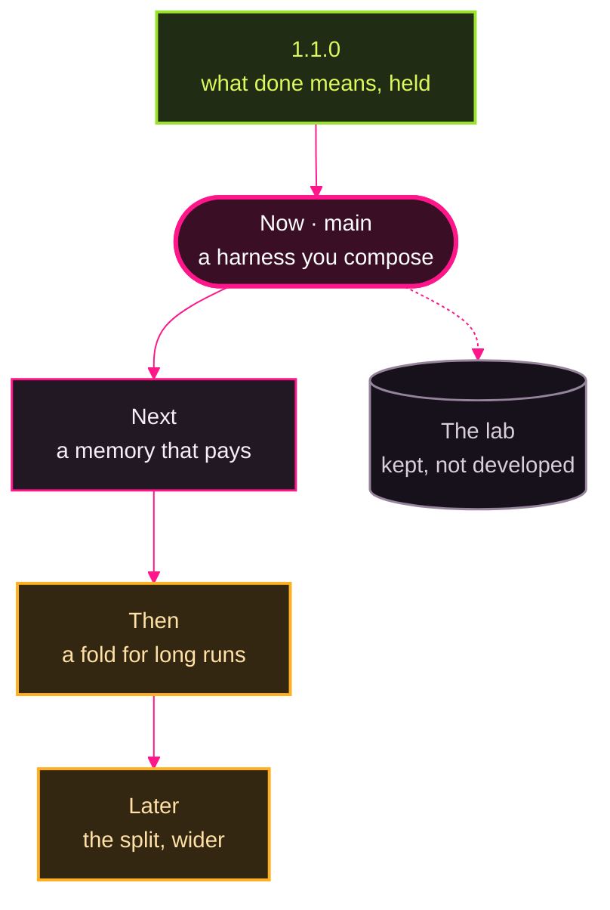

# Roadmap

What comes next for Mikata, in order. Each step is measured on [the bench](bench.md) before the
book says anything of it: a bar written first, then the runs, then the verdict, whatever it says.
How everything so far was built, milestone by milestone, is [M0 to M14](experimental/roadmap-m0-m14.md).

## In one picture

## Now: main after 1.1.0, a harness you compose

1.0.0 was the first release as Mikata. 1.1.0 (21 November) holds what came of the largest gap we
had measured, asks without examples: a `## Done when` list in the ask, held by the harness; a
reader that writes it; and the list of what changed when an answer lands
([releasing](releasing.md)). Since then, on `main`, for the next release:

- **Every part of the loop is a unit, and plugins load while a session runs** (experimental):
  units switched by configuration, by `--units` or live, profiles for a kind of work, plugins
  that speak MCP plus `mikata/hook` ([plugins](experimental/plugins.md)).
- **A leaner loop:** `multiedit` retired, a command's own `/tmp`, a refusal that says why.
- **A session that learns from a mistake:** a first failure remembered under its ask, your
  correction held as a line of that ask's list, `/wrong` in the terminal ([memory](07-memory.md)).
- **The faces:** the terminal UI as a dashboard, and the board's Harness Builder, both in
  Mikata's design system; the site is live at mikata.kaginari.org.
- **The plan off by default** (#466). The prompt's plan (write a `Done when` list and run each
  line before answering) was most of what the units cost: switched off, Haiku took 208 calls
  against 370 on ten fixes, 10 of 10 each, and 29 of 30 in 744 calls against 30 of 30 in 1,000 on
  thirty ([plugins: where it stands](experimental/plugins.md#where-it-stands)); with qwen on prose
  asks the plan passed 3 of 12 and none 5. On mathjs, twenty fixes an arm with qwen: no plan 17,
  the plan 17, a `todo` the body keeps when it wants 17, Maki 15; no plan the cheapest Mikata, at
  1.18 times Maki's dollars a pass. The plan and a lighter one stay a switch away; the todo,
  level, is not merged.

## Next: asks without examples

The largest gap we have measured. An ask with examples of its expected output passed 4 times in 4;
the same ask as one paragraph of prose, 4 times in 8. The failure is a misreading: the body turns
its own reading of the ask into its checks, they pass, and it answers done. Four lines added to the
prompt did not help (2 of 8), so the next try changes what the body does, not what it is told.

A second head does not close it either ([the bench](bench.md#what-did-not-help)): three runs and a
picker, a model settling their disagreements, and a model auditing what one run changed all
missed the bars we wrote for them. Two things held. By code alone, the list of what a body's own
commands print before and after its work shows the mistake in 14 of 16 failed runs. And where two
runs contradict each other on a case, the ask is unclear there. Both are things to show you, not
things a model can settle.

**Built: the list.** A landed answer is followed by what changed, by the body's own checks
([the loop](02-loop.md#what-changed-by-its-own-checks)). **Measured**
([the bench](bench.md#what-changed-measured)): a wrong value is in its twenty lines in 18 of 26
failed runs, and in one passed run in four it shows a break the tests missed. A stand-in human
pointing at one wrong line got the work passing in 6 of 18 runs, where a second try alone got 0:
under the bar we wrote, so the list stays what it is, a thing to read, and no loop is built on
it. Open: it is silent when a run stops with no answer, and on an ask that adds a syntax the
failed runs show no wrong value in twenty lines by any order we tried.
**Not built: the one case.** Two bodies that contradict each other on a case, put to you as a
question, costs a second run; it waits until the list has been lived with.

**Built: what done means, held by the harness.** An ask may carry its own `## Done when` list,
yours or one a reader you name writes from the ask alone, and the harness holds the work to it
([the loop](02-loop.md#a-done-when-list-in-the-ask)). **Measured**
([the bench](bench.md#the-list-held)): on the two prose asks that fail nearly always, 1 of 6
plain, 2 of 6 with the lines handed over as a note, 6 of 6 held, with each of two lists. The
half a body does not hold is what must stay, and the harness can: it has the code as the ask
found it. As it ships, a reader named and nothing added to the ask, the four prose asks passed
10 of 12 on the release itself (12 of 12 on a first screen of two builds) against 6 of 12; a list
did not cost the asks that already passed (12 of 12 over both screens, plain 5 of 6). Open, and
next:

- **A reader's spelling of what the code prints.** The largest loss left: three of the four
  runs a reader has lost on the release. The reader never saw the code. On one prose ask it
  writes a unit in small letters about half the time, where the code prints capitals: a list in
  capitals passed 6 of 6, a list in small letters 4 of 7. On an ask with examples it added a
  struct of its own without the colon the code writes, the body changed the generator to match,
  and a task that passes plain failed. The harness sets letter case aside and the body builds to
  the letter all the same; a colon it cannot set aside. The `check` tool's own words already say
  to keep the code's spelling, and did not prevent it. **Tried, three ways, and none shipped**
  ([the bench](bench.md#what-did-not-help)): a sentence at the hand-in naming the word (3 of 6,
  against 4 of 6); a landing failed once for the list's letters with a way out offered (2 of 6);
  the same with none offered (4 of 6 where we asked 5, the code's letters back every time). The
  last is kept on a branch: if a whole build is screened again for another reason, it can stand
  in that screen under that screen's bar. Not tried: the reader's own words, so that an output
  the request does not write is not stated letter by letter; and the colon, where the command
  does not run on the code as found and the harness has no spelling to compare.
- **What the hold earns.** The same twelve lists passed 10 of 12 held and 11 of 12 handed over
  as a note that nothing holds, and the note cost less: $0.26 a run against $0.37
  ([the bench](bench.md#the-list-held)). The hold was built on a smaller screen that said the
  opposite. What it gives beyond passes is real and unmeasured: a pass that names what verified
  it, and what must stay read from the code. What it costs is measured: dollars, calls, and a
  reader's wrong letters made binding. On the second codebase the cost showed again: of the
  reader arm's ten passes two did not land (one could not make its own checks run, one was held
  to two wrong lines of the reader's), and one run landed "verified" by 21 checks that were all
  an `echo`. The same lists as a note passed 8 of 12 there against 10 held: over both codebases
  20 of 24 held and 19 of 24 as a note. So twelve runs an arm cannot show what the hold is
  worth, and what it costs can be counted: a quarter to four tenths more dollars a run than the
  note, up to twice the calls, and in one night four held runs (one of them a trial of a fix)
  whose code was right and whose landing failed. To decide, bar first: a
  reader's list put in the ask as a note by default, held only when you ask for it, against
  the release as it is, on fresh lists, with enough runs to see two in twelve. Your own list
  stays held: you have seen the code and the reader has not.
- **When a reader pays.** On four prose asks it took 6 of 12 to 10 of 12. On the ten single
  fixes, whose asks carry their examples, it changed nothing we can show (7 of 9 both ways), at
  a third more a run, and 47% more on the tasks that pass either way. With a stronger body
  (Claude Haiku 5.5) the prose asks pass 12 of 12 unaided: the reader had no room, cost as much
  as the run itself, and one landing in twelve failed on a wrong line of its list. On prose asks
  in a second codebase, with the small model: 10 of 12 held against 8 plain, under the bar, at
  twice the price a run, the whole gap on one ask; and 8 of 12 with the lists as a note. So far
  a reader is shown to pay for a weak body on an ask without examples in one codebase, and
  nowhere else we have looked. Today
  the reader is called on every ask that carries no list. To try: let it answer that the ask
  already fixes its outputs, and write only what must stay.
- **What the habit costs where it is not needed.** Mikata writes down what done means and
  checks each line. On the fixes it was built on that took it from 5 of 10 to level with the
  others at half their price. On ten smaller fixes in a second codebase it is level and costs
  three times what Maki does a pass; with a stronger body all three pass everything and Maki
  finishes in half Mikata's calls ([the bench](bench.md#a-second-codebase)). The habit is one
  size for every ask and every body. To try, bar first: let the size of the list follow the
  ask, and measure calls a pass on the small fixes with passes on the hard ones held where they
  are.
- **A copy that cannot run the project.** A `must stay` line handed in late is read from a copy
  of the world, and what changed is shown from two. Until a second codebase was run the copies
  left `node_modules` out, and on a JavaScript project almost nothing ran in them: 8 checks of
  70 over ten runs ([lessons](lessons.md#measured-on-mikatas-own-bench)). Fixed for that case: a
  copy is lent the world's `node_modules`. The same gap is open wherever code needs what a copy
  does not carry: build output that takes longer than a check's 20 seconds to make again
  (`target`), a package installed in place from the world's own path, a tool that must write
  beside its dependencies. To do before either feature is trusted on such a project: run both
  there once. Until then a check that fails in a copy is counted as failing on the finished
  work, and that may be the copy's doing.
- **A check that only prints the words.** Five runs in twenty-six handed in commands that never
  run the code, one of them an `echo` for each of its 28 lines. Three passes of the first screen
  were held by them; none of the release's twelve, where the gate failed the one landing that
  kept them. The pass names every line whose check gave its output before the work; nothing
  refuses one, and nothing names one for a line that must stay. To try, bar first: say at the
  hand-in that an output printed before any change shows nothing, and run each check once with
  the code out of reach, where a command that still prints the same cannot be reading it.
- **A line that states no exact output.** A reader writes some lines as prose ("must give a
  list holding exactly one ... node"). The body's own wording is refused, and three runs in four
  then wrote a command that prints the line's own words when the tree has that shape: a real
  check, at the price of a few refusals. To try: ask the reader for a command's exact output in
  every line that must give.
- **A check that tests another case than its line.** Twice the gate held a landing for it; one
  body found the command, one ran out of steps. To try: say in the gate's note that two lines
  which cannot both hold mean one command is wrong.
- **The same model as its own reader** wrote a list wrong by a letter, and with the reader's
  prompt gave no line at all in 8,000 tokens of thought. A reader has to read better than the
  body.

## Next: a memory that pays

Memory is kept, carried, recalled and used, and on work that already passes it has not paid.
Carried through ten tasks three times over with two models, it changed no pass in sixty runs and
saved no calls by the bar written first; with the stronger model the rounds cost a fifth to a
half more dollars than the same tasks cold ([the bench](bench.md#memory-carried-from-task-to-task)).
Three faults found on the way are fixed: lessons written as a list were dropped, a marked heading
was kept as a lesson, and a task that came again was not always shown its own notes.

On work that fails and is asked again, memory keeping the human's corrections keeps every case
they named right, where a session without it breaks one it had right, and leaves fewer cases
wrong. More passes are shown only with the code starting over at each attempt; with the code
kept, the two pass alike ([the bench](bench.md#memory-told-it-was-wrong)). What comes next, in order:

- **The same rounds with a verify line.** Everything measured ran with nothing configured: no
  check behind a landing, so no note is ever grounded, the body is shown every note as unproven
  and under review, and a failure never reaches memory. The design's proof comes from the
  project's own test command, which the README asks for. To do first, bar first: the three
  rounds and their cold arm with a verify line, on the codebase where the bench has one. About
  $15, two bodies.
- **Learning from a mistake: what is shown, and what is left.** Built because the campaign
  showed memory could not: a first failure is remembered under its ask, a session that stops
  leaves an account, the human can say an answer was wrong (`mikatad memory wrong`), and what
  they say must come out is held as a line of that ask's list from then on
  ([memory](07-memory.md#reconsolidation)). Five screens: a correction that is told is taken up
  and overruled; held, it sticks; kept by memory, three of them brought 7 asks of 8 to pass.
  Left to show: the same with a body that needs it less; the session without memory run as far
  as the one with it (it was stopped at its third attempt, where its next word was the first
  again); a tree that keeps its code between attempts, as a real one does; and the two other
  paths, a failure by the gate and a stop, which have their tests and one sighting each in a
  paid run, and no screen.
- **The human's word, in the session: built, not measured.** `/wrong` in the terminal UI shows
  what would be held, or that the words are advice, before `/keep` keeps it; the core's command
  and the session share one act. Left: the web board; a correction read from the human's next
  message when a reader model is named (offered, never kept without `/keep`); and a screen that
  shows people phrase it so that it is held.
- **A check that cannot run is not a check that fails: built, not measured.** Twice a run on a
  JavaScript codebase handed in checks that load a file a source tree does not have, was told
  "fails on your work" at every landing, and never repaired them; the second time its code was
  right on every case it had been given. The harness now says the two apart, at hand-in and at
  the gate ([the loop](02-loop.md#a-done-when-list-in-the-ask)). Tests replay the case with its
  real error. Not shown: that a body told so repairs its command. To screen, bar first, on the
  ask where it happened.
- **A check that runs another case: built, screened once.** A held line is held to what its
  check prints, and twice with Claude Haiku 5.5 the check for the human's line ran the case the
  other way round and the answer landed with it wrong. The human may now name their own command
  (`--check`), which the harness hands in and no check of the model's replaces; without one, a
  check that prints the answer before any work is questioned at hand-in
  ([the loop](02-loop.md#a-done-when-list-in-the-ask)). Screened on that task, six runs: none
  landed with a named case wrong, where two of six had. Left: a check the model writes for a line
  of the ask's own, or a reader's, can still run another case.
- **The same lesson, written by every session.** Thirty runs left 28 copies of one fact, 16 of
  them written by a session that had it in its ask. Their words differ too much to drop a copy
  by its words (two share a median 0.18). To try: say at the hand-in which lessons are already
  kept, and count a repeat as the same lesson seen again.
- **What a body pays for what it remembers.** With the stronger model every arm that started
  from a memory did more than a cold one for the same result, and three arms of ten runs could
  not say which part of the memory does it; the one cause we named was wrong. Two arms of the
  same kind stand 8% apart by themselves. To do before any more arms: enough runs to see a
  tenth (three a task), then the parts again.

## Then: a fold for long runs

When a run's context fills, Mikata today summarises the whole history, at most twice, and then
stops at a checkpoint. On one model that wall was the only cause of failure (3 of 13 runs). The plan
borrows the mechanism of *Model-Driven Incremental Hierarchical Compression* (Ran, 2026): fold only
the new stretch of the run, append it after the ask, keep every folded stretch restorable to a file.
First the harness folds; only then, if a screen says it pays, the body gets its own `fold` tool.

## Later: the split, wider

Today an ask is split only across folders at the root of the repository that each hold a project of
their own. Whether the same split pays inside one repository, across the packages of a workspace,
is not measured yet.

## Kept, not developed: the lab

Structured-coding and collective-coding stay usable and documented in [the lab](experimental/),
and frozen: no work and no bench runs on them until there is work where structure should clearly
win.
